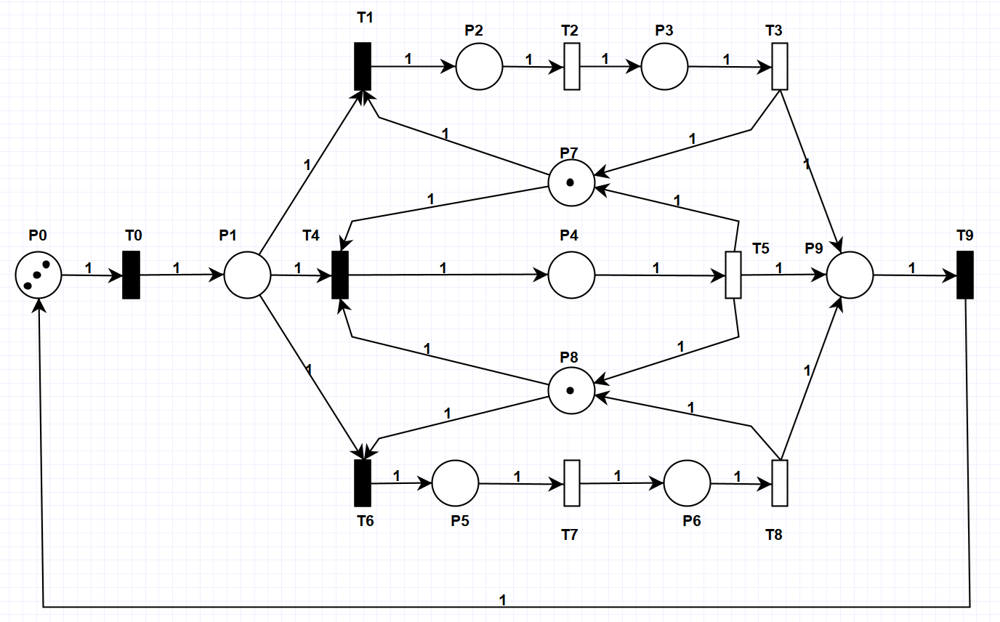

# TpFinalPCyP-Los_Deadlock

## Programación Concurrente y Paralela 2026

### Trabajo Práctico Final

#### Red de Petri : Sistema de Procesamiento de Transacciones de Pago

*Figura 1: Red de Petri a trabajar.*