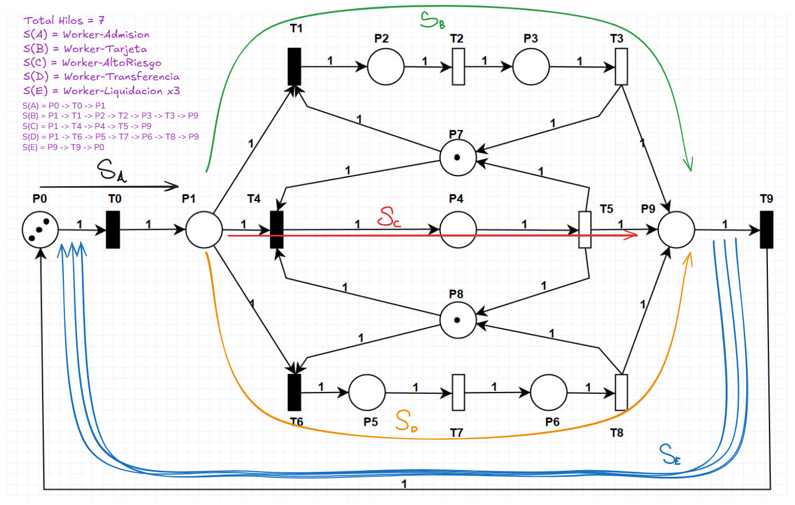

Parte Thomas <- Borrar al final
---
# Arquitectura de Hilos

La red de nuestro trabajo, pertenece a la clase $S^3 PR$, ya que es una composición de procesos secuenciales simples que comparten recursos.[^1]

[^1]: Ventre, L. Micolini, O (2026). *Algoritmos para determinar cantidad y responsabilidad
de hilos en sistemas embebidos modelados con Redes de
Petri $S^3PR$*. FCEFyN.

### Primera Parte

Aplicamos el algoritmo para la determinación de hilos máximos activos simultáneos; con esto calculamos cual es el paralelismo real máximo de la red para cualquier instante.

#### 1. Invariantes de Transición $IT$:
- $IT_1 = {T_0, T_1, T_2, T_3, T_9} \rightarrow$ Flujo Tarjetas
- $IT_1 = {T_0, T_4, T_5, T_9} \rightarrow \hspace{5mm}$ Flujo Alto Riesgo
- $IT_1 = {T_0, T_6, T_7, T_8, T_9} \rightarrow$ Flujo Transferencia

#### 2. Clasificación de Plaza:
- Plazas "Idle": $\hspace{1cm} PI_{idle} = {P_0}$ (Arribo)
- Plazas "Resource": $\hspace{3mm} PI_{recursos} = {P_7, P_8}$ (Gateway y Antifraud)
- Plazas "Restriction": $\hspace{1mm} PI_{restriccion} = \emptyset$

#### 3. Plazas de acción $PA_i = PI_i - {PI_{restriccion} \cup PI_{resources} \cup PI_{idle}}$

- $PA_1 = {P_1,P_2,P_3,P_9}$
- $PA_2 = {P_1,P_4,P_9}$
- $PA_3 = {P_1,P_5,P_6,P_9}$
- Conjunto total: $PA=\bigcup PA_i = {P_1,P_2,P_3,P_4,P_5,P_6,P_9}$

#### 4. Marcado máximo en $PA(\max(MA))$
- Por invariante de plaza de transacciones: $M(P_0) + \sum_{p\in PA} M(p)$. Al tener las 3 transacciones ingresadas en el sistema $(M(P_0)=0)$, la suma de tokens en $PA$ alcanza su máximo valor posible: 3.
- Por lo tanto, la cantidad máxima de hilos activos simultáneamente en el sistema es 3.

### Segunda Parte

Como los tres invariantes de transición comparten un inicio en $T_0$ antes del conflicto en $P_1$ y convergen antes de $P_9$ antes de $T_9$, se aplican los casos 2 y 3 del algoritmo para segmentar y responsabilizar la red. En nuestro caso vemos una división en 5 segmentos de ejecución.

Sabemos que segmentar antes del conflicto elimina del los hilos lógica de decisión; por lo que la resolución del conflicto queda delegada al módulo "Política" dentro del Monitor. Tambien sabemos que separar el tramo posterior a la convergencia (*join*) permite que lo posterior quede en paralelo con los segmentos previos (*fork*).

- Segmento $S_A$:
$$Responsable\ de\ {T_0} ; \quad PS_A = {P_1}$$
- Segmento $S_B$:
$$Responsable\ de\ {T_1, T_2, T_3} ; \quad PS_A = {P_2, P_3}$$
- Segmento $S_C$:
$$Responsable\ de\ {T_4, T_5} ; \quad PS_A = {P_4}$$
- Segmento $S_D$:
$$Responsable\ de\ {T_6, T_7, T_8} ; \quad PS_A = {P_5, P_6}$$
- Segmento $S_E$:
$$Responsable\ de\ {T_9} ; \quad PS_A = {P_9}$$

### Tercera Parte

Analizamos la cantidad de hilos por segmento según lo estipulado por el paper y por el enunciado.

- Segmenos de procesamiento $S_B, S_C, S_D$

Por los invariantes de recursos: $M(P_7) + M(P_2) + M(P_3) + M(P_4) = 1 \wedge M(P_8) + M(P_4) + M(P_5) + M(P_6) = 1$, tenemos que cada una de estas ramas admite como máximo 1 solo token simultáneo $\therefore \max(MS_B) = \max(MS_C) = \max(MS_D) = 1 \Rightarrow$ 1 hilo por rama.

- Segmento posterior al *join* $S_E$

Como $M_0(P_0) = 3$, en el arbol de alcanzabilidad pueden acumularse hasta 3 tokens simultáneos en $P_9$: $\max(MS_E) = 3 \Rightarrow$ 3 hilos para ${T_9}$

- Segmento previo al *fork* $S_A$

Al aplicar estrictamente el algoritmo del paper, como $M(P_1)$ puede llegar a 3 si $T_0$ se dispara 3 veces seguidas, $\max(MS_A) = 3$. Por lo que tendríamos 9 hilos en total.

Pero en el enunciado se pide que "debe haber un hilo encargado de la ejecución de la transición anterior al conflicto y luego un hilo por invariante". Al $T_0$ ser una transición inmediata ie. $[0, 0] ms$ y el monitor opera con un disparo por ciclo, 1 hilo para $S_A$ alimenta $P_!$ sin bottleneck, lo que da un total de 7 hilos.

#### Interaccion de Hilos con Monitor

- Semántica de disparo único

El monituor evalúa la ecuación de estado:

$$M_{j+1} = M_j + I \cdot \sigma$$

Con esta, calcula el vector de transiciones sensibilizadas, detectando signos no negativos en el próximo estado posible, y lo cruza con las solicitudes de los hilos en colas de condición. Como se dispara una transición por vez en MutEx, los hilos compiten simplemente llamando a `monitor.fireTransition(t)` en bucle

- Semántica temporal

Las transiciones inmediatas ${T_0,T_1,T_4,T_6,T_9}$ tienen intervalo $[0, 0]$ por lo que se disparan instantáneamente al sensibilizarse, mientras que ${T_2,T_3,T_5,T_7,T_8}$ tienen un intervalo puntual $[min, max] ms$. Los hilos llaman a `.fireTransition()` de manera uniforme; el monitor gestiona internamente el timer de cada transición sensibilizada. En nuestro caso, se nos pide un tiempo estático de disparo *min* por lo que si bien es un intervalo $[EFT, LFT]$, nuestro Earliest Firing Time sería *min* y nuestro Latest Firing Time sería $\infty$ donde la transición debe esperar al menos *min* milisegundos para dispararse en cuento pueda hacerlo.

- Trazabilidad

Poseemos un `FileTransitionLogger` que cumple el rol de *Output Queue* para contar cada disparo realizado. Se invoca el logger dentro de la sección crítica del monitor justo luego de actualizar el vector de marcado $M$, de esa forma garantizando que el orden del archivo de log coincida 1:1 con la secuencia real de los estados de la red.

### Tablas

|Plaza|Tipo|Segmento|Descripción en Dominio|Marcado Inicial|Cota Máx|
|---|---|---|---|---|---|
|$P_0$|Idle|-|Cola arribo de transacciones entrantes al sistema|3|3|
|$P_1$|Acción|$S_A$|Transacción admitida, lista para ruteo|0|3|
|$P_2$|Acción|$S_B$|Pago con tarjeta: Solicitud enviada, aguardando respuesta issuer|0|1|
|$P_3$|Acción|$S_B$|Pago con tarjeta: Autorización aprobada, lista para capturar fondos|0|1|
|$P_4$|Acción|$S_C$|Pago alto riesgo: Evaluación simultánea antifraude y gateway|0|1|
|$P_5$|Acción|$S_D$|Transferencia bancaria: Validación de cuenta destino|0|1|
|$P_6$|Acción|$S_D$|Transferencia bancaria: Cuenta validada, lista para ejecutar transferencia en red bancaria|0|1|
|$P_7$|Recurso|-|Sesión disponible con gateway de red tarjetas|1|1|
|$P_8$|Recurso|-|Sesión disponible con motor de antifraude|1|1|
|$P_9$|Recurso|$S_E$|Buffer salida: Transacciones procesadas listas para confirmar y liquidar|0|3|

**Tabla 1: Estados del Sistema**

|Transición|Semántica Temporal|Segmento|Hilo Asignado|Acción en Sistema|Recursos Manipulados|
|---|---|---|---|---|---|
|$T_0$|Inmediata $[0,0]$|$S_A$|*Worker-Admision*|Adminsión de Transacción|-|
|$T_1$|Inmediata $[0,0]$|$S_B$|*Worker-Tarjeta*|Enrutamiento a flujo de tarjeta, inicio autorización|Toma $P_7$|
|$T_2$|Temporal $[min,\infty)$|$S_B$|*Worker-Tarjeta*|Recepción de gateway|Retiene $P_7$|
|$T_3$|Temporal $[min,\infty)$|$S_B$|*Worker-Tarjeta*|Confirmacion captura fondos con tarjeta|Libera $P_7$|
|$T_4$|Inmediata $[0,0]$|$S_C$|*Worker-AltoRiesgo*|Enrutamiento a flujo alto riesgo|Toma $P_7 \wedge P_8$|
|$T_5$|Temporal $[min,\infty)$|$S_C$|*Worker-AltoRiesgo*|Finalización scoring y aprobación de riesgo|Libera $P_7 \wedge P_8$|
|$T_6$|Inmediata $[0,0]$|$S_D$|*Worker-Transferencia*|Enrutamiento a flujo de transferencia|Toma $P_8$|
|$T_7$|Temporal $[min,\infty)$|$S_D$|*Worker-Transferencia*|Finalización de validación cuenta destino|Retiene $P_8$|
|$T_8$|Temporal $[min,\infty)$|$S_D$|*Worker-Transferencia*|Ejecución de transferencia|Libera $P_8$|
|$T_9$|Inmediata $[0,0]$|$S_E$|*Worker-Liquidacion_i(1,2,3)*|Confirmación al cliente, liquidación, y liberación|Devuelve token a $P_0$|

**Tabla 2: Eventos del Sistema**

### Gráfico de Responsabilidades de Hilos

*Imagen n : Grafico de Hilos en Red de Petri*

---