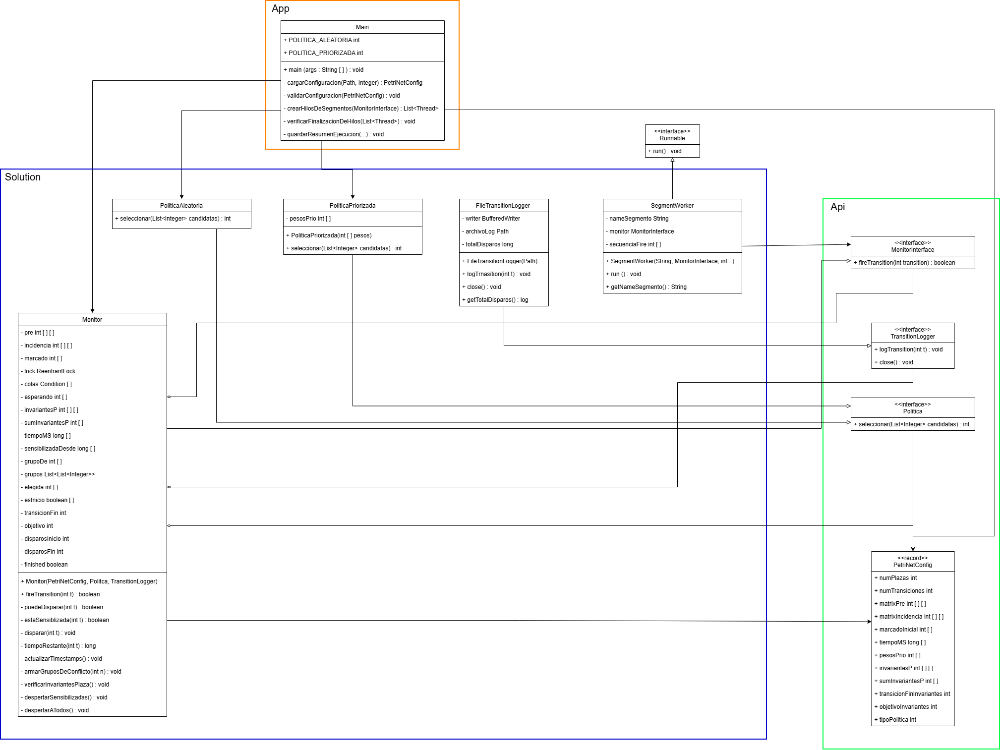
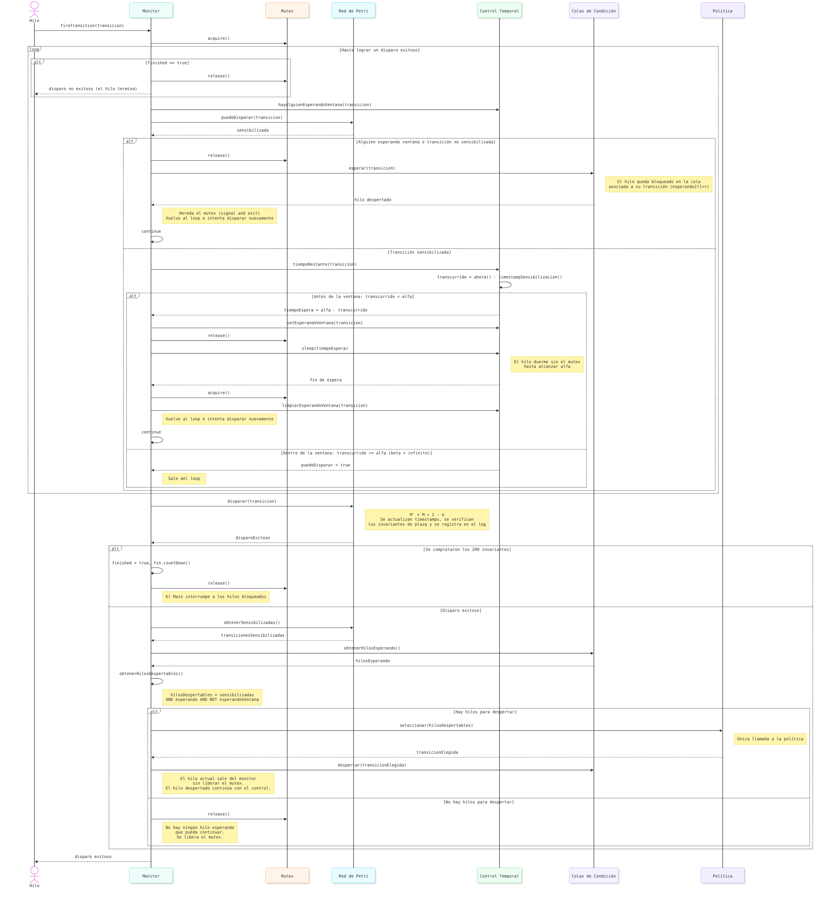
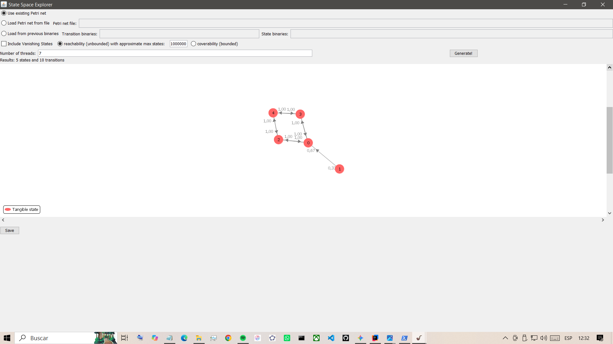

# UNIVERSIDAD NACIONAL DE CÓRDOBA

## FACULTAD DE CIENCIAS EXACTAS, FÍSICAS, Y NATURALES

### CÁTEDRA DE PROGRAMACIÓN CONCURRENTE Y PARALELA

**TRABAJO PRÁCTICO N°2 - RED DE PETRI : SISTEMA DE PROCESAMIENTO DE TRANSACCIONES DE PAGO**

**Alumnos:**

* Barbero Giovanna Luz - (46509956)
* von Büren Thomas - (43136697)
* Frenguelli Guillermina - (45154313)
* Fernández María Clara - (44428018)

**Profesores:**

* Ing. Luis Orlando Ventre
* Ing. Mauricio Ludemann
* Ing. Agustin Carranza
* Ing. Gabriel Valenzuela

**Comisión:** ICOMP24-3

**Año:** 2026

---



*Figura 1: Diagrama de Clase.*



*Figura 2: Diagrama de Secuencia - Disparo de una transición en el monitor (semáforos, signal and exit).*


*Figura 3: Red de Petri a trabajar.*

## Arquitectura de Hilos

La red de nuestro trabajo, pertenece a la clase $S^3 PR$, ya que es una composición de procesos secuenciales simples que comparten recursos.[^1]

[^1]: Ventre, L. Micolini, O (2026). *Algoritmos para determinar cantidad y responsabilidad
de hilos en sistemas embebidos modelados con Redes de
Petri $S^3PR$*. FCEFyN.

### Primera Parte

Aplicamos el algoritmo para la determinación de hilos máximos activos simultáneos; con esto calculamos cual es el paralelismo real máximo de la red para cualquier instante.

#### 1. Invariantes de Transición $IT$:
- $IT_1 = {T_0, T_1, T_2, T_3, T_9} \rightarrow$ Flujo Tarjetas
- $IT_1 = {T_0, T_4, T_5, T_9} \rightarrow \hspace{5mm}$ Flujo Alto Riesgo
- $IT_1 = {T_0, T_6, T_7, T_8, T_9} \rightarrow$ Flujo Transferencia

#### 2. Clasificación de Plaza:
- Plazas "Idle": $\hspace{1cm} PI_{idle} = {P_0}$ (Arribo)
- Plazas "Resource": $\hspace{3mm} PI_{recursos} = {P_7, P_8}$ (Gateway y Antifraud)
- Plazas "Restriction": $\hspace{1mm} PI_{restriccion} = \emptyset$

#### 3. Plazas de acción $PA_i = PI_i - {PI_{restriccion} \cup PI_{resources} \cup PI_{idle}}$

- $PA_1 = {P_1,P_2,P_3,P_9}$
- $PA_2 = {P_1,P_4,P_9}$
- $PA_3 = {P_1,P_5,P_6,P_9}$
- Conjunto total: $PA=\bigcup PA_i = {P_1,P_2,P_3,P_4,P_5,P_6,P_9}$

#### 4. Marcado máximo en $PA(\max(MA))$
- Por invariante de plaza de transacciones: $M(P_0) + \sum_{p\in PA} M(p)$. Al tener las 3 transacciones ingresadas en el sistema $(M(P_0)=0)$, la suma de tokens en $PA$ alcanza su máximo valor posible: 3.
- Por lo tanto, la cantidad máxima de hilos activos simultáneamente en el sistema es 3.

### Segunda Parte

Como los tres invariantes de transición comparten un inicio en $T_0$ antes del conflicto en $P_1$ y convergen antes de $P_9$ antes de $T_9$, se aplican los casos 2 y 3 del algoritmo para segmentar y responsabilizar la red. En nuestro caso vemos una división en 5 segmentos de ejecución.

Sabemos que segmentar antes del conflicto elimina del los hilos lógica de decisión; por lo que la resolución del conflicto queda delegada al módulo "Política" dentro del Monitor. Tambien sabemos que separar el tramo posterior a la convergencia (*join*) permite que lo posterior quede en paralelo con los segmentos previos (*fork*).

- Segmento $S_A$:
$$Responsable\ de\ {T_0} ; \quad PS_A = {P_1}$$
- Segmento $S_B$:
$$Responsable\ de\ {T_1, T_2, T_3} ; \quad PS_A = {P_2, P_3}$$
- Segmento $S_C$:
$$Responsable\ de\ {T_4, T_5} ; \quad PS_A = {P_4}$$
- Segmento $S_D$:
$$Responsable\ de\ {T_6, T_7, T_8} ; \quad PS_A = {P_5, P_6}$$
- Segmento $S_E$:
$$Responsable\ de\ {T_9} ; \quad PS_A = {P_9}$$

### Tercera Parte

Analizamos la cantidad de hilos por segmento según lo estipulado por el paper y por el enunciado.

- Segmenos de procesamiento $S_B, S_C, S_D$

Por los invariantes de recursos: $M(P_7) + M(P_2) + M(P_3) + M(P_4) = 1 \wedge M(P_8) + M(P_4) + M(P_5) + M(P_6) = 1$, tenemos que cada una de estas ramas admite como máximo 1 solo token simultáneo $\therefore \max(MS_B) = \max(MS_C) = \max(MS_D) = 1 \Rightarrow$ 1 hilo por rama.

- Segmento posterior al *join* $S_E$

Como $M_0(P_0) = 3$, en el arbol de alcanzabilidad pueden acumularse hasta 3 tokens simultáneos en $P_9$: $\max(MS_E) = 3 \Rightarrow$ 3 hilos para ${T_9}$

- Segmento previo al *fork* $S_A$

Como $M(P_1)$ puede llegar a 3 si $T_0$ se dispara 3 veces seguidas, $\max(MS_A) = 3 $. 

3 hilos para $S_A$ alimentan $P_1$ sin bottleneck, lo que da un total de 9 hilos.

#### Interaccion de Hilos con Monitor

- Semántica de disparo único

El monituor evalúa la ecuación de estado:

$$M_{j+1} = M_j + I \cdot \sigma$$

Con esta, calcula el vector de transiciones sensibilizadas, detectando signos no negativos en el próximo estado posible, y lo cruza con las solicitudes de los hilos en colas de condición. Como se dispara una transición por vez en MutEx, los hilos compiten simplemente llamando a `monitor.fireTransition(t)` en bucle

- Semántica temporal

Las transiciones inmediatas ${T_0,T_1,T_4,T_6,T_9}$ tienen intervalo $[0, 0]$ por lo que se disparan instantáneamente al sensibilizarse, mientras que ${T_2,T_3,T_5,T_7,T_8}$ tienen un intervalo puntual $[min, max] ms$. Los hilos llaman a `.fireTransition()` de manera uniforme; el monitor gestiona internamente el timer de cada transición sensibilizada. En nuestro caso, se nos pide un tiempo estático de disparo *min* por lo que si bien es un intervalo $[EFT, LFT]$, nuestro Earliest Firing Time sería *min* y nuestro Latest Firing Time sería $\infty$ donde la transición debe esperar al menos *min* milisegundos para dispararse en cuento pueda hacerlo.

- Trazabilidad

Poseemos un `FileTransitionLogger` que cumple el rol de *Output Queue* para contar cada disparo realizado. Se invoca el logger dentro de la sección crítica del monitor justo luego de actualizar el vector de marcado $M$, de esa forma garantizando que el orden del archivo de log coincida 1:1 con la secuencia real de los estados de la red.

### Tablas

|Plaza|Tipo|Segmento|Descripción en Dominio|Marcado Inicial|Cota Máx|
|---|---|---|---|---|---|
|$P_0$|Idle|-|Cola arribo de transacciones entrantes al sistema|3|3|
|$P_1$|Acción|$S_A$|Transacción admitida, lista para ruteo|0|3|
|$P_2$|Acción|$S_B$|Pago con tarjeta: Solicitud enviada, aguardando respuesta issuer|0|1|
|$P_3$|Acción|$S_B$|Pago con tarjeta: Autorización aprobada, lista para capturar fondos|0|1|
|$P_4$|Acción|$S_C$|Pago alto riesgo: Evaluación simultánea antifraude y gateway|0|1|
|$P_5$|Acción|$S_D$|Transferencia bancaria: Validación de cuenta destino|0|1|
|$P_6$|Acción|$S_D$|Transferencia bancaria: Cuenta validada, lista para ejecutar transferencia en red bancaria|0|1|
|$P_7$|Recurso|-|Sesión disponible con gateway de red tarjetas|1|1|
|$P_8$|Recurso|-|Sesión disponible con motor de antifraude|1|1|
|$P_9$|Recurso|$S_E$|Buffer salida: Transacciones procesadas listas para confirmar y liquidar|0|3|

**Tabla 1: Estados del Sistema**

|Transición|Semántica Temporal|Segmento| Hilo Asignado                 |Acción en Sistema|Recursos Manipulados|
|---|---|---|-------------------------------|---|---|
|$T_0$|Inmediata $[0,0]$|$S_A$| *Worker-Admision_i(1,2,3)*    |Adminsión de Transacción|-|
|$T_1$|Inmediata $[0,0]$|$S_B$| *Worker-Tarjeta*              |Enrutamiento a flujo de tarjeta, inicio autorización|Toma $P_7$|
|$T_2$|Temporal $[min,\infty)$|$S_B$| *Worker-Tarjeta*              |Recepción de gateway|Retiene $P_7$|
|$T_3$|Temporal $[min,\infty)$|$S_B$| *Worker-Tarjeta*              |Confirmacion captura fondos con tarjeta|Libera $P_7$|
|$T_4$|Inmediata $[0,0]$|$S_C$| *Worker-AltoRiesgo*           |Enrutamiento a flujo alto riesgo|Toma $P_7 \wedge P_8$|
|$T_5$|Temporal $[min,\infty)$|$S_C$| *Worker-AltoRiesgo*           |Finalización scoring y aprobación de riesgo|Libera $P_7 \wedge P_8$|
|$T_6$|Inmediata $[0,0]$|$S_D$| *Worker-Transferencia*        |Enrutamiento a flujo de transferencia|Toma $P_8$|
|$T_7$|Temporal $[min,\infty)$|$S_D$| *Worker-Transferencia*        |Finalización de validación cuenta destino|Retiene $P_8$|
|$T_8$|Temporal $[min,\infty)$|$S_D$| *Worker-Transferencia*        |Ejecución de transferencia|Libera $P_8$|
|$T_9$|Inmediata $[0,0]$|$S_E$| *Worker-Liquidacion_i(1,2,3)* |Confirmación al cliente, liquidación, y liberación|Devuelve token a $P_0$|

**Tabla 2: Eventos del Sistema**

### Gráfico de Responsabilidades de Hilos


*Imagen 1 : Grafico de Hilos en Red de Petri*

---

## Análisis de la Red de Petri en PIPE

Para garantizar la validez estructural y dinámica del sistema antes de su implementación, se modeló la Red de Petri Estocástica Generalizada en PIPE v5.0.2 y se ejecutaron los módulos de exploración del espacio de estados y análisis estacionario.

### Estructura de la Red y Clasificación de Elementos

La red modela el procesamiento concurrente de transacciones mediante tres flujos alternativos que compiten por dos recursos comparitdos:

* Plazas de flujo y control: `P0` representa la cola de entrada con un marcado inicial $M_0(P_0) = 3$ (nivel máximo de concurrencia simultánea). `P1` modela el punto de admisión y enrutamiento; `P2`- `P6` representan las etapas internas de cada rama de procesamiento; y `P9`constituye el buffer de salida previo al retorno del ciclo.
* Plazas de recursos compartidos: `P7` y `P8` inician con $1$ token cada una ($M_0(P_7) = 1$, $M_0(P_8) = 1$), modelando recursos de acceso exclusivo.
* Transiciones inmediatas (`T0`, `T1`, `T4`, `T6`, `T9`): Representadas por barras negras; se disparan sin retardo temporal en cuanto se habilitan.
* Transiciones temporizadas (`T2`, `T3`, `T5`, `T7`, `T8`): Representadas por rectángulos blancos; introducen retardos asociados al tiempo de procesamiento de cada etapa.

---

### Análisis de Invariantes (P-invariantes y T-invariantes)

#### Invariantes de Plaza (P-invariantes)
Los P-invariantes definen leyes lineales de conservación de tokens que se mantienen constantes para cualquier estado alcanzable de la red:

1. Conservación total de transacciones en el sistema:
   $$M(P_0) + M(P_1) + M(P_2) + M(P_3) + M(P_4) + M(P_5) + M(P_6) + M(P_9) = 3$$
   Interpretación: El número total de transacciones circulando entre la entrada, las tres ramas de procesamiento y la salida es siempre igual a $3$. No se crean ni se pierden hilos de trabajo durante la ejecución.

2. Exclusión mutua sobre el recurso `P7`:
   $$M(P_7) + M(P_2) + M(P_3) + M(P_4) = 1$$
   Interpretación: El recurso `P7` permanece libre ($M(P_7)=1$) o asignado exclusivamente a una única transacción en la rama superior (`P2`, `P3`) o en la rama central (`P4`), impidiendo el acceso simultáneo.

3. Exclusión mutua sobre el recurso `P8`:
   $$M(P_8) + M(P_4) + M(P_5) + M(P_6) = 1$$
   Interpretación: El recurso `P8` permanece libre ($M(P_8)=1$) o asignado exclusivamente a una transacción en la rama central (`P4`) o en la rama inferior (`P5`, `P6`).

#### Invariantes de Transición (T-invariantes)
Los T-invariantes representan las secuencias mínimas de disparos que procesan una transacción completa y devuelven la red a su marcado inicial:

* T-invariante 1 (Flujo superior — usa `P7`):
  $$T_0 \rightarrow T_1 \rightarrow T_2 \rightarrow T_3 \rightarrow T_9$$
* T-invariante 2 (Flujo central — usa `P7` y `P8` en simultáneo):
  $$T_0 \rightarrow T_4 \rightarrow T_5 \rightarrow T_9$$
* T-invariante 3 (Flujo inferior — usa `P8`):
  $$T_0 \rightarrow T_6 \rightarrow T_7 \rightarrow T_8 \rightarrow T_9$$

Todas las transiciones de la red están cubiertas por al menos un T-invariante, condición estructural necesaria para la vivacidad del modelo.


### Verificación del Espacio de Estados (Reachability Graph)

Mediante el módulo *State Space Explorer* de PIPE se generó tanto el grafo reducido a estados tangibles como el grafo completo incluyendo estados evanescentes (vanishing states):

* Grafo reducido (estados tangibles): Consta de 5 estados tangibles y 10 transiciones. Tras abandonar el estado inicial (`State 1`), el sistema evoluciona dentro de un ciclo cerrado compuesto por los estados `0`, `2`, `3` y `4`.



* Grafo completo (tangibles + evanescentes): Al incluir los estados intermedios instantáneos (vanishing), el espacio alcanza exactamente 33 estados (5 tangibles y 28 evanescentes) y 56 transiciones, confirmando que el espacio de estados es finito.


A partir de ambos grafos se verifican las propiedades formales exigidas:

| Propiedad                     | Estado en PIPE                            | Justificación Formal |
|:------------------------------|:------------------------------------------| :--- |
| **Ausencia de *Deadlock***    | Verificada (Deadlock-free)                | Ningún nodo del grafo es un estado sumidero; desde todo estado alcanzable existe al menos una transición habilitada. |
| **Vivacidad (Liveness)**      | Viva                                      | Los estados tangibles `0`, `2`, `3` y `4` conforman una componente fuertemente conexa donde todas las transiciones ($T_0$–$T_9$) pueden volver a dispararse indefinidamente. |
| **Acotamiento (Boundedness)** | 3-Acotada                                 | El espacio tiene un número finito de estados (33). Ninguna plaza supera los 3 tokens en ningún estado alcanzable. |
| **Seguridad (1-Safeness)**    | Parcial (1-segura en recursos e internas) | Las plazas `P2`–`P8` nunca superan 1 token, mientras que las plazas de cola/buffer (`P0`, `P1`, `P9`) alcanzan hasta 3 tokens debido al marcado inicial $M_0(P_0) = 3$. |

---

### Análisis Estocástico en Estado Estacionario (GSPN Analysis)

Al ejecutar el módulo GSPN Analysis en PIPE (con tasas exponenciales unitarias por defecto $\lambda = 1,0$ en las transiciones temporizadas), se obtuvieron los siguientes indicadores en régimen estacionario:

#### Marcado de los Estados Tangibles
| Estado | `P0` | `P1` | `P2` | `P3` | `P4` | `P5` | `P6` | `P7` | `P8` | `P9` |
| :---: | :---: | :---: | :---: | :---: | :---: | :---: | :---: | :---: | :---: | :---: |
| **0** | 0 | 1 | 1 | 0 | 0 | 1 | 0 | 0 | 0 | 0 |
| **1** | 0 | 2 | 0 | 0 | 1 | 0 | 0 | 0 | 0 | 0 |
| **2** | 0 | 1 | 1 | 0 | 0 | 0 | 1 | 0 | 0 | 0 |
| **3** | 0 | 1 | 0 | 1 | 0 | 1 | 0 | 0 | 0 | 0 |
| **4** | 0 | 1 | 0 | 1 | 0 | 0 | 1 | 0 | 0 | 0 |

#### Distribución Estacionaria, Ocupación Media y Throughput
| Estado | Probabilidad Estacionaria | Plaza | Promedio de Tokens ($\bar{M}$) | Transición Temporizada | *Throughput* Medio |
| :---: | :---: | :---: | :---: | :---: | :---: |
| **0** | `0,250` | `P0` / `P9` | `0,000` | `T2` | `0,500` |
| **1** | `0,000` | `P1` | `1,000` | `T3` | `0,500` |
| **2** | `0,250` | `P2` / `P3` | `0,500` | `T5` | `0,000` |
| **3** | `0,250` | `P4` | `0,000` | `T7` | `0,500` |
| **4** | `0,250` | `P5` / `P6` | `0,500` | `T8` | `0,500` |
| — | — | `P7` / `P8` | `0,000` | — | — |


#### Interpretación del Comportamiento Estacionario
Los resultados revelan un fenómeno crítico de contención de recursos:

1. Saturación de recursos y paralelismo: Los recursos `P7` y `P8` presentan una ocupación libre promedio de `0,000` (100 % de utilización), mientras que en la plaza de admisión `P1` permanece en promedio `1,000` token esperando disponibilidad de recursos.
2. Inanición (Starvation) de la rama central sin política de arbitraje: El estado `1` (único estado tangible donde se ejecuta la rama central `P4`) tiene probabilidad estacionaria `0,000`, y el *throughput* de `T5` es nulo (`0,000`). Esto ocurre porque `T4` requiere adquirir `P7` y `P8` simultáneamente; dado que las ramas superior (`T1`–`T3`) e inferior (`T6`–`T8`) operan en paralelo y liberan `P7` y `P8` en instantes asíncronos, el token en espera en `P1` captura inmediatamente el primer recurso que se libera (`T1` o `T6`), impidiendo que ambos queden libres a la vez.

---

### Conexión con la Implementación y Experimentación en Java

* Validación de ejecución: Los tres T-invariantes deducidos definen exactamente las expresiones regulares utilizadas por el validador post-ejecución para auditar los 200 ciclos completados en el archivo de log.
* Justificación de políticas de planificación: La inanición teórica observada en `T5` bajo el modelo estocástico sin arbitraje fundamenta la necesidad de implementar y contrastar dos políticas de resolución de conflictos en el Monitor de Java, cuyos tiempos reales (determinísticos en milisegundos) y distribución de carga se analizan en las secciones siguientes.

---

## Monitor de Concurrencia

El monitor es el componente central del sistema: coordina el acceso de los hilos a la red de Petri de forma que, en cada instante, como máximo un hilo modifica su estado. No ejecuta las acciones del sistema; decide qué hilo puede disparar, cuál debe esperar y a cuál se despierta.

### Diseño general

La clase `Monitor` implementa `MonitorInterface` y expone un único método público:

    boolean fireTransition(int transition)

Cada hilo invoca este método con la transición que desea disparar. Devuelve `true` si el disparo se realizó, o `false` cuando el sistema finalizó y el hilo debe terminar.

El monitor es **agnóstico a la red**: no contiene referencias a transiciones ni plazas particulares. Todo lo que depende de la red se recibe en el constructor a través de `PetriNetConfig` (matriz Pre $I^-$, matriz de incidencia $I$, marcado inicial $M_0$, tiempos, invariantes de plaza, transición de fin y cantidad objetivo de invariantes). Lo único que necesita conocer de la estructura, la transición de entrada, lo calcula a partir de las matrices.

El monitor está implementado con **semáforos**:

|Elemento|Implementación|Función|
|---|---|---|
|Mutex|`Semaphore(1, true)`|Exclusión mutua sobre el estado de la red|
|Colas de condición|Un `Semaphore(0, true)` por transición|Bloquear a los hilos cuya transición no puede dispararse|
|Contador de espera|`int[] esperando`|Cantidad de hilos bloqueados en cada cola|

### Exclusión mutua

El mutex es un semáforo binario creado en modo justo, de manera que los hilos acceden al monitor en el orden en que lo solicitaron. Todo hilo ejecuta `mutex.acquire()` al entrar a `fireTransition`, y el estado de la red (marcado, timestamps, contadores) solo se lee y modifica mientras se posee el mutex.

Dentro de la sección crítica, el monitor evalúa si la transición está sensibilizada comparando el marcado con la matriz Pre:

$$t \text{ sensibilizada} \iff M(p) \geq I^-(p, t) \quad \forall p$$

y, si corresponde, dispara aplicando la ecuación de estado:

$$M_{j+1} = M_j + I \cdot \sigma$$

donde $\sigma$ es el vector de disparo con un 1 en la posición de $t$.

### Disciplina de señalización: Signal and Exit

Cuando un hilo dispara y despierta a otro, **no libera el mutex**: hace `release()` sobre la cola del hilo elegido y sale del monitor. El hilo despertado continúa su ejecución con el mutex "heredado", sin volver a solicitarlo. Si no hay ningún hilo para despertar, recién entonces se ejecuta `mutex.release()`.

Esto garantiza que **el hilo señalizado es el próximo en ejecutar dentro del monitor**: ningún hilo de la cola de entrada puede adelantarse y modificar el estado entre la señalización y la reanudación del despertado.

Esta disciplina es posible gracias a que un semáforo **no tiene dueño**: cualquier hilo puede hacer `release()` sobre un semáforo, aunque no haya sido quien hizo `acquire()`. Con un `ReentrantLock` esto no es posible, porque solo el hilo que lo adquirió puede liberarlo, y el hilo despertado debería competir por el lock con los que esperan en la entrada.

### Colas de condición

Cuando un hilo solicita una transición que no puede dispararse, se bloquea en la cola de condición de esa transición:

1. Incrementa `esperando[t]`.
2. Libera el mutex (`mutex.release()`).
3. Ejecuta `colas[t].acquire()`. Como el semáforo está en 0, el hilo queda bloqueado sin consumir CPU.

El contador se incrementa antes de liberar el mutex, de modo que ningún otro hilo pueda observar un estado en el que el hilo está por bloquearse pero todavía no figura como esperando, y así no se pierden señales.

Cuando otro hilo lo despierta con `colas[t].release()`, el hilo bloqueado continúa **ya en posesión del mutex** (Signal and Exit) y vuelve al inicio del ciclo de `fireTransition` para evaluar nuevamente su transición.

### Política de resolución de conflictos

La política se consulta en **un único punto**: después de cada disparo exitoso, para decidir a qué hilo despertar. El monitor construye el vector de transiciones despertables:

$$despertables(i) = sensibilizada(i) \land esperando(i) > 0 \land \lnot esperandoVentana(i)$$

y se lo entrega completo a la política mediante `politica.seleccionar(despertables)`, que devuelve la transición elegida o $-1$ si no hay ninguna. Si eligió una transición, el monitor despierta a un hilo de su cola sin liberar el mutex; si no, libera el mutex.

Un hilo que llega al monitor y encuentra su transición sensibilizada la dispara directamente, sin consultar a la política, porque no hay ninguna elección que hacer.

Se implementaron dos políticas, ambas independientes de la red:

- **Aleatoria:** elige con igual probabilidad entre las transiciones despertables.
- **Priorizada:** elige la transición despertable de mayor peso según `politica.pesos` del archivo de configuración ($T_4$, flujo de alto riesgo); ante empate, elige al azar.

Cada decisión en la que hubo dos o más candidatas se registra en un log de decisiones (candidatas y elegida), que permite verificar el cumplimiento de cada política.

### Semántica temporal

Las transiciones $T_2, T_3, T_5, T_7$ y $T_8$ son temporales. Se implementó una semántica de **tiempo mínimo**: cada transición temporal tiene un tiempo $\alpha$ (en milisegundos, definido en `config.properties`) y solo puede dispararse cuando transcurrieron al menos $\alpha$ ms desde que quedó sensibilizada. El intervalo de disparo es $[\alpha, \infty)$.

|Transición|$\alpha$ (ms)|
|---|---|
|$T_2$|130|
|$T_3$|130|
|$T_5$|200|
|$T_7$|130|
|$T_8$|130|

El monitor guarda en `sensibilizadaDesde[t]` el instante en que cada transición quedó sensibilizada, y lo actualiza después de cada disparo. Cuando un hilo encuentra su transición sensibilizada, calcula el tiempo restante:

$$t_{restante} = \alpha_t - (t_{actual} - t_{sensibilizada})$$

Si $t_{restante} > 0$, el hilo:

1. marca `esperandoVentana[t] = true`,
2. libera el mutex,
3. duerme `Thread.sleep(t_restante)`,
4. vuelve a adquirir el mutex, desmarca `esperandoVentana[t]` y reevalúa todo desde el inicio.

Dormir fuera del mutex mantiene el paralelismo: mientras una transacción espera, los demás hilos siguen disparando. La marca `esperandoVentana` evita que otro hilo se adelante y dispare la transición por la que alguien está esperando: si un hilo encuentra esa marca, se bloquea en la cola, y esa transición tampoco se considera despertable mientras dure la espera.
### Verificación de invariantes de plaza

Después de cada disparo, y todavía en posesión del mutex, el monitor verifica los invariantes de plaza. Cada invariante está definido en la configuración como un vector de coeficientes $v_i$ y una constante $k_i$, y se comprueba que:

$$v_i \cdot M = \sum_{p} v_i(p) \cdot M(p) = k_i$$

Para nuestra red se verifican:

- $M(P_0) + M(P_1) + M(P_2) + M(P_3) + M(P_4) + M(P_5) + M(P_6) + M(P_9) = 3$
- $M(P_2) + M(P_3) + M(P_4) + M(P_7) = 1$
- $M(P_4) + M(P_5) + M(P_6) + M(P_8) = 1$

Si alguna suma difiere de su constante, se lanza una `IllegalStateException` que indica el invariante violado. Antes de propagar la excepción, el monitor libera el mutex, para que ningún otro hilo quede bloqueado indefinidamente.

La verificación se realiza dentro de la sección crítica porque lee el marcado: fuera de ella, otro hilo podría disparar en medio de la suma y el resultado no correspondería a ningún estado real de la red.

### Registro de disparos y decisiones

Inmediatamente después de cada disparo, y dentro de la sección crítica, el monitor invoca `logger.logTransition(t)`. Esto garantiza que el orden de las transiciones en el log coincida con el orden real de los disparos, condición necesaria para la verificación de los invariantes de transición mediante expresiones regulares.

Además, cada vez que la política decide entre dos o más transiciones despertables, el monitor registra la decisión con `logger.logDecision(candidatas, elegida)`. Este registro se utiliza para demostrar el cumplimiento de las políticas: cuántas veces cada transición fue candidata y cuántas fue elegida.

### Finalización del sistema

El programa debe terminar al completarse 200 invariantes de transición, sin dejar hilos activos.

**Límite de entradas.** El monitor identifica la transición de entrada a partir de las matrices: es la que consume tokens de la plaza a la que la transición de fin devuelve el token (en nuestra red, $T_0$, que consume de $P_0$). Esa transición puede dispararse como máximo 200 veces. Así, al alcanzar el objetivo no quedan transacciones a medio procesar, y el log contiene exactamente 200 invariantes completos.

**Detección del fin.** El monitor cuenta los disparos de la transición de fin ($T_9$). Cuando el contador alcanza el objetivo:

1. marca `finished = true`,
2. ejecuta `fin.countDown()` sobre un `CountDownLatch` compartido con el `Main`,
3. libera el mutex.

A partir de ese momento, todo hilo que entra al monitor encuentra `finished = true`, libera el mutex y recibe `false`.

**Terminación de los hilos.** Los hilos bloqueados en una cola de condición no pueden enterarse del fin por sí mismos, ya que un semáforo no permite despertar a todos sus hilos a la vez. Por eso el `Main`, que espera con `fin.await()`, interrumpe a todos los hilos (`interrupt()`). Un hilo bloqueado en `acquire()` o en `sleep()` recibe una `InterruptedException`, y `fireTransition` devuelve `false`. Cada hilo finaliza su ciclo al recibir `false`, y el `Main` espera a todos con `join()` antes de verificar que ninguno quede activo.

La variable `finished` no se declara `volatile` porque solo se lee y se escribe en posesión del mutex, y la adquisición y liberación del semáforo garantizan la visibilidad de los cambios entre hilos.

## Validación de Invariantes con Expresión Regular

Para comprobar que cada ejecución completa exactamente $200$ T-invariantes, y que cada uno respeta el orden causal de la red, el archivo de *log* de disparos se valida con la clase `ValidadorRegex`. Esta clase usa una única expresión regular que contiene los tres T-invariantes como alternativas.

### Preprocesamiento

Primero se extraen del *log* todos los tokens de la forma `T<número>` (patrón `\bT[0-9]+\b`) y se los une con espacios. Así se obtiene una cadena con la secuencia completa de disparos, por ejemplo: `T0 T0 T1 T6 T2 T7 T3 T8 T9 T9 ...`.

### Expresión regular

```
^(.*)\bT0\b(.*?)(?:\bT1\b(.*?)\bT2\b(.*?)\bT3\b|\bT4\b(.*?)\bT5\b|\bT6\b(.*?)\bT7\b(.*?)\bT8\b)(.*?)\bT9\b(.*)$
```

| Parte | Significado |
| :--- | :--- |
| `^(.*)` | Todo lo anterior al `T0` del invariante que se reconoce (grupo 1). |
| `\bT0\b` | Admisión de la transacción. |
| `(.*?)` | Disparos de otros invariantes intercalados entre `T0` y la rama (grupo 2). |
| `(?: ... \| ... \| ... )` | Alternativa entre las tres ramas: Tarjeta `T1 … T2 … T3`, Alto riesgo `T4 … T5` y Transferencia `T6 … T7 … T8`. Los grupos internos capturan lo que está intercalado entre cada par de transiciones de la rama. |
| `(.*?)\bT9\b` | Disparos intercalados antes de la liquidación (grupo 8) y la liquidación `T9`. |
| `(.*)$` | Todo lo posterior al `T9` (grupo 9). |

Los delimitadores `\b` evitan coincidencias parciales, como confundir `T1` con `T10`. Los cuantificadores perezosos `.*?` hacen que se tomen las transiciones más cercanas que completan el invariante.

### Algoritmo de reconocimiento

1. Se aplica la expresión sobre la cadena completa (`matches()`).
2. Si coincide, se identifica qué invariante se reconoció según el grupo que capturó: grupo 3 para Tarjeta, grupo 5 para Alto riesgo y, en otro caso, Transferencia. Se incrementa el contador correspondiente.
3. Se reconstruye la cadena concatenando todos los grupos capturados. Es decir, se eliminan únicamente las transiciones del invariante reconocido y se conservan los disparos de otros invariantes que estaban intercalados entre ellas. Esto es lo que permite validar un *log* concurrente, donde los invariantes no aparecen contiguos.
4. Se repite hasta que la cadena quede vacía o la expresión ya no coincida.

El *log* es válido solo si la cadena final queda vacía y el total reconocido es exactamente 200. Si sobran transiciones, el validador informa el remanente.

**Ejemplo con dos invariantes intercalados:**

| Paso | Cadena | Invariante reconocido |
| :---: | :--- | :--- |
| 0 | `T0 T0 T1 T6 T2 T7 T3 T8 T9 T9` | — |
| 1 | `T0 T6 T7 T8 T9` | Tarjeta (se eliminan `T0 T1 T2 T3 T9`) |
| 2 | *(vacía)* | Transferencia (se eliminan `T0 T6 T7 T8 T9`) |

### Pruebas con logs rotos

La clase de test `ValidadorInvariantesTest` verifica que el validador acepta los *logs* correctos y rechaza los alterados manualmente:

| Caso de prueba | Resultado esperado |
| :--- | :--- |
| Log secuencial con 200 invariantes | Válido |
| Log con invariantes intercalados (concurrente) | Válido |
| Se elimina una transición intermedia (`T2`) | Inválido: quedan transiciones huérfanas |
| Se invierte el orden causal (`T2` antes que `T1`) | Inválido |
| Se agrega una transición suelta (`T4`) | Inválido: el remanente contiene `T4` |
| Ciclo truncado al final (`T0 T1 T2`) | Inválido: remanente `T0 T1 T2` |
| 199 o 201 invariantes | Inválido: cantidad incorrecta |
| Log vacío o nulo | Inválido |

Además, se alteró a mano un *log* real de ejecución (200 invariantes válidos) y en todos los casos el validador detectó el error:

| Alteración sobre el log real | Remanente informado |
| :--- | :--- |
| Ninguna (original) | — (válido, 200 invariantes) |
| Se elimina el primer `T2` | `T0 T3` |
| Se intercambia el primer `T1` con el siguiente `T2` | `T0 T2` |
| Se agrega un `T5` suelto al final | `T5` |
| Se reemplaza el primer `T9` por `T8` | `T0 T8` |

## Análisis Temporal: Modelo Analítico vs. Ejecución Práctica

### Configuración base

Cada transición temporizada tiene un tiempo mínimo $\alpha$ con intervalo $[\alpha, \infty)$: solo puede dispararse una vez transcurridos al menos $\alpha$ ms desde que quedó sensibilizada. Las transiciones inmediatas (`T0`, `T1`, `T4`, `T6`, `T9`) tienen $\alpha = 0$.

Configuración base en `config/config.properties`:

```
red.tiempos.ms=0,0,130,130,0,200,0,130,130,0
politica.pesos=1,1,1,1,3,1,1,1,1,1
```

| T-Invariante (Flujo) | Secuencia | Recurso(s) ocupado(s) | Duración por ciclo ($D_i$) |
| :--- | :--- | :--- | :---: |
| **Tarjeta** | $T_0 \rightarrow T_1 \rightarrow T_2 \rightarrow T_3 \rightarrow T_9$ | `P7` (gateway) | $D_1 = 130 + 130 = \mathbf{260\text{ ms}}$ |
| **Alto riesgo** | $T_0 \rightarrow T_4 \rightarrow T_5 \rightarrow T_9$ | `P7` y `P8` en simultáneo | $D_2 = \mathbf{200\text{ ms}}$ |
| **Transferencia** | $T_0 \rightarrow T_6 \rightarrow T_7 \rightarrow T_8 \rightarrow T_9$ | `P8` (antifraude) | $D_3 = 130 + 130 = \mathbf{260\text{ ms}}$ |

### Modelo analítico

Por los P-invariantes $M(P_2)+M(P_3)+M(P_4)+M(P_7)=1$ y $M(P_4)+M(P_5)+M(P_6)+M(P_8)=1$, cada recurso atiende una sola transacción a la vez:

1. Ramas laterales en paralelo. Tarjeta usa solo `P7` y Transferencia usa solo `P8`, por lo que pueden ejecutarse simultáneamente. Su aporte está dado por el recurso más exigido: $\max(N_1 \cdot D_1,\; N_6 \cdot D_3)$.
2. Rama central serializada. Cada transacción de Alto riesgo toma `P7` y `P8` a la vez y los retiene durante $D_2$, deteniendo ambas ramas laterales. Su aporte es $N_4 \cdot D_2$.

$$T_{\text{ideal}} = N_4 \cdot D_2 + \max\left(N_1 \cdot D_1,\; N_6 \cdot D_3\right)$$

Con $D_1 = D_3 = D$ y, como se observa en todas las corridas, $N_1 \approx N_6 = \frac{200 - N_4}{2}$:

$$T_{\text{ideal}} = 100 \cdot D + N_4 \cdot \left(D_2 - \frac{D}{2}\right) = 26\text{ s} + 0{,}07\text{ s} \cdot N_4$$

Así, la configuración base acota el tiempo entre $26\text{ s}$ (si no hubiera ninguna transacción de alto riesgo) y $40\text{ s}$ (si las 200 fueran de alto riesgo). Esto garantiza que se cumple la ventana de 20 a 40 segundos para cualquier distribución de ramas. Cada transacción de alto riesgo agrega $70$ ms al tiempo total, porque bloquea las dos ramas laterales durante 200 ms en lugar de ocupar una sola durante 260 ms.

La cantidad total de disparos es $1000 - N_4$: los invariantes de Tarjeta y Transferencia tienen 5 transiciones y el de Alto riesgo tiene 4.

### Resultados experimentales (configuración base)

Se realizaron 5 ejecuciones por política. Cada *log* se validó con `ValidadorRegex`. La columna "T4 elegida / candidata" se obtiene del *log* de decisiones (`decisiones_*.log`): cuenta en cuántas decisiones `T4` estaba entre las despertables y en cuántas fue la elegida.

| Política | Corrida | $(N_1, N_4, N_6)$ | Disparos | T4 elegida / candidata | $T_{\text{ideal}}$ | $T_{\text{práctico}}$ | Diferencia |
| :--- | :---: | :---: | :---: | :---: | :---: | :---: | :---: |
| Aleatoria | 1 | (97, 7, 96) | 993 | 3 / 14 | 26,62 s | 26,72 s | +0,10 s |
| Aleatoria | 2 | (91, 18, 91) | 982 | 15 / 27 | 27,26 s | 27,36 s | +0,10 s |
| Aleatoria | 3 | (99, 2, 99) | 998 | 2 / 3 | 26,14 s | 26,23 s | +0,09 s |
| Aleatoria | 4 | (92, 16, 92) | 984 | 11 / 26 | 27,12 s | 27,22 s | +0,10 s |
| Aleatoria | 5 | (94, 13, 93) | 987 | 7 / 20 | 27,04 s | 27,14 s | +0,11 s |
| **Aleatoria** | **Promedio** | $N_4 = 11{,}2$ | | **38 / 90 (42 %)** | **26,84 s** | **26,94 s** | **+0,10 s** |
| Priorizada | 1 | (96, 9, 95) | 991 | 9 / 9 | 26,76 s | 26,85 s | +0,09 s |
| Priorizada | 2 | (92, 16, 92) | 984 | 15 / 15 | 27,12 s | 27,22 s | +0,10 s |
| Priorizada | 3 | (95, 10, 95) | 990 | 10 / 10 | 26,70 s | 26,79 s | +0,09 s |
| Priorizada | 4 | (91, 18, 91) | 982 | 17 / 17 | 27,26 s | 27,36 s | +0,10 s |
| Priorizada | 5 | (96, 8, 96) | 992 | 8 / 8 | 26,56 s | 26,65 s | +0,09 s |
| **Priorizada** | **Promedio** | $N_4 = 12{,}2$ | | **59 / 59 (100 %)** | **26,88 s** | **26,98 s** | **+0,10 s** |

### Escenarios de variación temporal

Para evaluar la sensibilidad del sistema, se modificaron los tiempos manteniendo los mismos pesos:

| Escenario | `red.tiempos.ms` | $D_1 / D_2 / D_3$ | Modelo |
| :--- | :--- | :---: | :---: |
| **1. Base** | `0,0,130,130,0,200,0,130,130,0` | 260 / 200 / 260 ms | $26\text{ s} + 0{,}07\text{ s}\cdot N_4$ |
| **2. Alto riesgo pesado** | `0,0,130,130,0,400,0,130,130,0` | 260 / 400 / 260 ms | $26\text{ s} + 0{,}27\text{ s}\cdot N_4$ |
| **3. Laterales rápidas** | `0,0,100,100,0,200,0,100,100,0` | 200 / 200 / 200 ms | $20\text{ s} + 0{,}10\text{ s}\cdot N_4$ |

| Escenario | Política | $(N_1, N_4, N_6)$ | T4 elegida / candidata | $T_{\text{ideal}}$ | $T_{\text{práctico}}$ | Diferencia |
| :--- | :--- | :---: | :---: | :---: | :---: | :---: |
| 2. Alto riesgo pesado | Aleatoria | (92, 16, 92) | 11 / 25 | 30,32 s | 30,42 s | +0,10 s |
| 2. Alto riesgo pesado | Aleatoria | (97, 7, 96) | 5 / 10 | 28,02 s | 28,12 s | +0,10 s |
| 2. Alto riesgo pesado | Priorizada | (90, 19, 91) | 19 / 19 | 31,26 s | 31,37 s | +0,11 s |
| 2. Alto riesgo pesado | Priorizada | (97, 5, 98) | 5 / 5 | 27,48 s | 27,57 s | +0,09 s |
| 3. Laterales rápidas | Aleatoria | (98, 5, 97) | 3 / 9 | 20,60 s | 20,70 s | +0,10 s |
| 3. Laterales rápidas | Aleatoria | (92, 15, 93) | 10 / 22 | 21,60 s | 21,68 s | +0,08 s |
| 3. Laterales rápidas | Priorizada | (92, 15, 93) | 15 / 15 | 21,60 s | 21,68 s | +0,08 s |
| 3. Laterales rápidas | Priorizada | (89, 23, 88) | 22 / 22 | 22,40 s | 22,50 s | +0,10 s |

### Análisis de resultados

1. Cumplimiento de la ventana temporal. Las 18 ejecuciones terminaron entre $20{,}70$ y $31{,}37$ s, con los 9 hilos finalizados y exactamente 200 T-invariantes válidos en cada *log*.

2. Precisión del modelo. La diferencia entre $T_{\text{práctico}}$ y $T_{\text{ideal}}$ es prácticamente constante (entre $+0{,}08$ y $+0{,}11$ s) en todas las corridas y escenarios. El modelo predice tan bien porque el sistema está limitado por los recursos: con 9 hilos y 3 transacciones circulando, cada vez que un recurso se libera hay un hilo esperando para tomarlo, así que los recursos casi no quedan ociosos. Esa diferencia constante se atribuye a costos fijos de la ejecución: la creación de los hilos, la granularidad de `Thread.sleep()` y la escritura de los *logs*.

3. Baja proporción de alto riesgo. En todas las ejecuciones, $N_4$ es bajo (entre 2 y 23 transacciones, es decir, entre el 1 % y el 12 %) y varía mucho de una corrida a otra. La causa es estructural: `T4` necesita `P7` y `P8` libres al mismo tiempo, mientras que las ramas laterales mantienen ocupado al menos uno de los dos recursos casi todo el tiempo. `T4` solo queda sensibilizada en los pocos instantes en que ninguna de las dos ramas laterales tiene su recurso tomado.

4. Efecto de la política. La política priorizada cumple su función: en el 100 % de las decisiones en que `T4` era candidata, fue la elegida (59 de 59 en la configuración base). Con la política aleatoria, en cambio, fue elegida en el 42 % de esos casos (38 de 90). Sin embargo, el número de transacciones de alto riesgo es similar entre políticas, porque la política solo decide entre las transiciones despertables (sensibilizadas, con hilos esperando y fuera de la espera temporal): puede dar prioridad a `T4` cuando compite, pero no puede generar más instantes en que los dos recursos estén libres. Aumentar más la proporción de alto riesgo exigiría mantener un recurso libre esperando a que se libere el otro, y eso reduciría el paralelismo de las ramas laterales.

5. Sensibilidad a los tiempos. En el escenario 2, cada transacción de alto riesgo cuesta $270$ ms en lugar de $70$ ms, por lo que el tiempo total depende mucho más de $N_4$: pasa de $28{,}12$ s con $N_4 = 7$ a $31{,}37$ s con $N_4 = 19$. En el escenario 3, al acortar las ramas laterales, el tiempo se acerca al límite inferior de la ventana ($20{,}70$ a $22{,}50$ s). Esto muestra que la configuración base, con ramas de 260 ms, deja margen tanto respecto de los 20 s como de los 40 s.