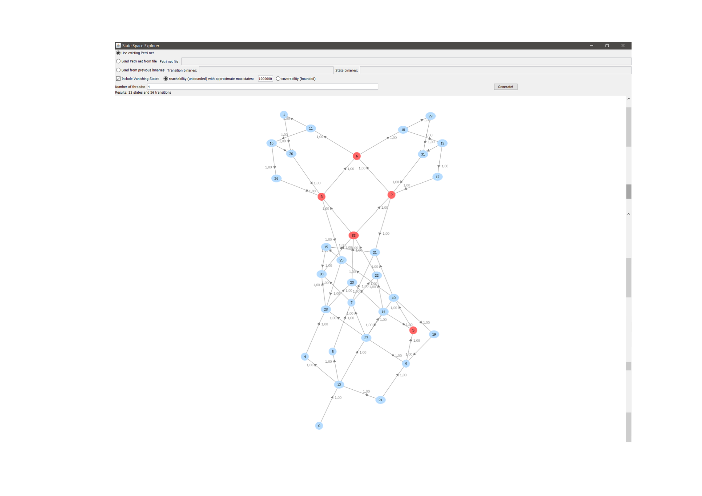
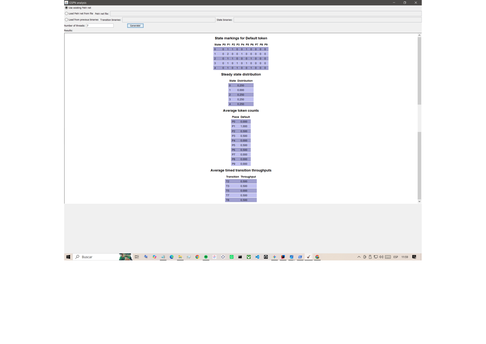

# UNIVERSIDAD NACIONAL DE CÓRDOBA

## FACULTAD DE CIENCIAS EXACTAS, FÍSICAS, Y NATURALES

### CÁTEDRA DE PROGRAMACIÓN CONCURRENTE Y PARALELA

**TRABAJO PRÁCTICO N°2 - RED DE PETRI : SISTEMA DE PROCESAMIENTO DE TRANSACCIONES DE PAGO**

**Alumnos:**

* Barbero Giovanna Luz - (46509956)
* von Büren Thomas - (43136697)
* Frenguelli Guillermina - (45154313)
* Fernández María Clara - (44428018)

**Profesores:**

* Ing. Luis Orlando Ventre
* Ing. Mauricio Ludemann
* Ing. Agustin Carranza
* Ing. Gabriel Valenzuela

**Comisión:** ICOMP24-3

**Año:** 2026

---

*Figura 1: Diagrama de Clase.*

*Figura 2: Diagrama de Secuencia - Disparo de una transición en el monitor (semáforos, signal and exit).*

*Figura 3: Red de Petri a trabajar.*

## Arquitectura de Hilos

La red de nuestro trabajo, pertenece a la clase $S^3 PR$, ya que es una composición de procesos secuenciales simples que comparten recursos.[^1]

[^1]: Ventre, L. Micolini, O (2026). *Algoritmos para determinar cantidad y responsabilidad
de hilos en sistemas embebidos modelados con Redes de
Petri $S^3PR$*. FCEFyN.

### Primera Parte

Aplicamos el algoritmo para la determinación de hilos máximos activos simultáneos; con esto calculamos cual es el paralelismo real máximo de la red para cualquier instante.

#### 1. Invariantes de Transición $IT$:
- $IT_1 = {T_0, T_1, T_2, T_3, T_9} \rightarrow$ Flujo Tarjetas
- $IT_1 = {T_0, T_4, T_5, T_9} \rightarrow \hspace{5mm}$ Flujo Alto Riesgo
- $IT_1 = {T_0, T_6, T_7, T_8, T_9} \rightarrow$ Flujo Transferencia

#### 2. Clasificación de Plaza:
- Plazas "Idle": $\hspace{1cm} PI_{idle} = {P_0}$ (Arribo)
- Plazas "Resource": $\hspace{3mm} PI_{recursos} = {P_7, P_8}$ (Gateway y Antifraud)
- Plazas "Restriction": $\hspace{1mm} PI_{restriccion} = \emptyset$

#### 3. Plazas de acción $PA_i = PI_i - {PI_{restriccion} \cup PI_{resources} \cup PI_{idle}}$

- $PA_1 = {P_1,P_2,P_3,P_9}$
- $PA_2 = {P_1,P_4,P_9}$
- $PA_3 = {P_1,P_5,P_6,P_9}$
- Conjunto total: $PA=\bigcup PA_i = {P_1,P_2,P_3,P_4,P_5,P_6,P_9}$

#### 4. Marcado máximo en $PA(\max(MA))$
- Por invariante de plaza de transacciones: $M(P_0) + \sum_{p\in PA} M(p)$. Al tener las 3 transacciones ingresadas en el sistema $(M(P_0)=0)$, la suma de tokens en $PA$ alcanza su máximo valor posible: 3.
- Por lo tanto, la cantidad máxima de hilos activos simultáneamente en el sistema es 3.

### Segunda Parte

Como los tres invariantes de transición comparten un inicio en $T_0$ antes del conflicto en $P_1$ y convergen antes de $P_9$ antes de $T_9$, se aplican los casos 2 y 3 del algoritmo para segmentar y responsabilizar la red. En nuestro caso vemos una división en 5 segmentos de ejecución.

Sabemos que segmentar antes del conflicto elimina del los hilos lógica de decisión; por lo que la resolución del conflicto queda delegada al módulo "Política" dentro del Monitor. Tambien sabemos que separar el tramo posterior a la convergencia (*join*) permite que lo posterior quede en paralelo con los segmentos previos (*fork*).

- Segmento $S_A$:
$$Responsable\ de\ {T_0} ; \quad PS_A = {P_1}$$
- Segmento $S_B$:
$$Responsable\ de\ {T_1, T_2, T_3} ; \quad PS_A = {P_2, P_3}$$
- Segmento $S_C$:
$$Responsable\ de\ {T_4, T_5} ; \quad PS_A = {P_4}$$
- Segmento $S_D$:
$$Responsable\ de\ {T_6, T_7, T_8} ; \quad PS_A = {P_5, P_6}$$
- Segmento $S_E$:
$$Responsable\ de\ {T_9} ; \quad PS_A = {P_9}$$

### Tercera Parte

Analizamos la cantidad de hilos por segmento según lo estipulado por el paper y por el enunciado.

- Segmenos de procesamiento $S_B, S_C, S_D$

Por los invariantes de recursos: $M(P_7) + M(P_2) + M(P_3) + M(P_4) = 1 \wedge M(P_8) + M(P_4) + M(P_5) + M(P_6) = 1$, tenemos que cada una de estas ramas admite como máximo 1 solo token simultáneo $\therefore \max(MS_B) = \max(MS_C) = \max(MS_D) = 1 \Rightarrow$ 1 hilo por rama.

- Segmento posterior al *join* $S_E$

Como $M_0(P_0) = 3$, en el arbol de alcanzabilidad pueden acumularse hasta 3 tokens simultáneos en $P_9$: $\max(MS_E) = 3 \Rightarrow$ 3 hilos para ${T_9}$

- Segmento previo al *fork* $S_A$

Como $M(P_1)$ puede llegar a 3 si $T_0$ se dispara 3 veces seguidas, $\max(MS_A) = 3 $. 

3 hilos para $S_A$ alimentan $P_1$ sin bottleneck, lo que da un total de 9 hilos.

#### Interaccion de Hilos con Monitor

- Semántica de disparo único

El monituor evalúa la ecuación de estado:

$$M_{j+1} = M_j + I \cdot \sigma$$

Con esta, calcula el vector de transiciones sensibilizadas, detectando signos no negativos en el próximo estado posible, y lo cruza con las solicitudes de los hilos en colas de condición. Como se dispara una transición por vez en MutEx, los hilos compiten simplemente llamando a `monitor.fireTransition(t)` en bucle

- Semántica temporal

Las transiciones inmediatas ${T_0,T_1,T_4,T_6,T_9}$ tienen intervalo $[0, 0]$ por lo que se disparan instantáneamente al sensibilizarse, mientras que ${T_2,T_3,T_5,T_7,T_8}$ tienen un intervalo puntual $[min, max] ms$. Los hilos llaman a `.fireTransition()` de manera uniforme; el monitor gestiona internamente el timer de cada transición sensibilizada. En nuestro caso, se nos pide un tiempo estático de disparo *min* por lo que si bien es un intervalo $[EFT, LFT]$, nuestro Earliest Firing Time sería *min* y nuestro Latest Firing Time sería $\infty$ donde la transición debe esperar al menos *min* milisegundos para dispararse en cuento pueda hacerlo.

- Trazabilidad

Poseemos un `FileTransitionLogger` que cumple el rol de *Output Queue* para contar cada disparo realizado. Se invoca el logger dentro de la sección crítica del monitor justo luego de actualizar el vector de marcado $M$, de esa forma garantizando que el orden del archivo de log coincida 1:1 con la secuencia real de los estados de la red.

### Tablas

|Plaza|Tipo|Segmento|Descripción en Dominio|Marcado Inicial|Cota Máx|
|---|---|---|---|---|---|
|$P_0$|Idle|-|Cola arribo de transacciones entrantes al sistema|3|3|
|$P_1$|Acción|$S_A$|Transacción admitida, lista para ruteo|0|3|
|$P_2$|Acción|$S_B$|Pago con tarjeta: Solicitud enviada, aguardando respuesta issuer|0|1|
|$P_3$|Acción|$S_B$|Pago con tarjeta: Autorización aprobada, lista para capturar fondos|0|1|
|$P_4$|Acción|$S_C$|Pago alto riesgo: Evaluación simultánea antifraude y gateway|0|1|
|$P_5$|Acción|$S_D$|Transferencia bancaria: Validación de cuenta destino|0|1|
|$P_6$|Acción|$S_D$|Transferencia bancaria: Cuenta validada, lista para ejecutar transferencia en red bancaria|0|1|
|$P_7$|Recurso|-|Sesión disponible con gateway de red tarjetas|1|1|
|$P_8$|Recurso|-|Sesión disponible con motor de antifraude|1|1|
|$P_9$|Recurso|$S_E$|Buffer salida: Transacciones procesadas listas para confirmar y liquidar|0|3|

**Tabla 1: Estados del Sistema**

|Transición|Semántica Temporal|Segmento| Hilo Asignado                 |Acción en Sistema|Recursos Manipulados|
|---|---|---|-------------------------------|---|---|
|$T_0$|Inmediata $[0,0]$|$S_A$| *Worker-Admision_i(1,2,3)*    |Adminsión de Transacción|-|
|$T_1$|Inmediata $[0,0]$|$S_B$| *Worker-Tarjeta*              |Enrutamiento a flujo de tarjeta, inicio autorización|Toma $P_7$|
|$T_2$|Temporal $[min,\infty)$|$S_B$| *Worker-Tarjeta*              |Recepción de gateway|Retiene $P_7$|
|$T_3$|Temporal $[min,\infty)$|$S_B$| *Worker-Tarjeta*              |Confirmacion captura fondos con tarjeta|Libera $P_7$|
|$T_4$|Inmediata $[0,0]$|$S_C$| *Worker-AltoRiesgo*           |Enrutamiento a flujo alto riesgo|Toma $P_7 \wedge P_8$|
|$T_5$|Temporal $[min,\infty)$|$S_C$| *Worker-AltoRiesgo*           |Finalización scoring y aprobación de riesgo|Libera $P_7 \wedge P_8$|
|$T_6$|Inmediata $[0,0]$|$S_D$| *Worker-Transferencia*        |Enrutamiento a flujo de transferencia|Toma $P_8$|
|$T_7$|Temporal $[min,\infty)$|$S_D$| *Worker-Transferencia*        |Finalización de validación cuenta destino|Retiene $P_8$|
|$T_8$|Temporal $[min,\infty)$|$S_D$| *Worker-Transferencia*        |Ejecución de transferencia|Libera $P_8$|
|$T_9$|Inmediata $[0,0]$|$S_E$| *Worker-Liquidacion_i(1,2,3)* |Confirmación al cliente, liquidación, y liberación|Devuelve token a $P_0$|

**Tabla 2: Eventos del Sistema**

### Gráfico de Responsabilidades de Hilos

*Imagen 1 : Grafico de Hilos en Red de Petri*

---

## Análisis de la Red de Petri en PIPE

Para garantizar la validez estructural y dinámica del sistema antes de su implementación, se modeló la Red de Petri Estocástica Generalizada en PIPE v5.0.2 y se ejecutaron los módulos de exploración del espacio de estados y análisis estacionario.

### Estructura de la Red y Clasificación de Elementos

La red modela el procesamiento concurrente de transacciones mediante tres flujos alternativos que compiten por dos recursos comparitdos:

* Plazas de flujo y control: `P0` representa la cola de entrada con un marcado inicial $M_0(P_0) = 3$ (nivel máximo de concurrencia simultánea). `P1` modela el punto de admisión y enrutamiento; `P2`- `P6` representan las etapas internas de cada rama de procesamiento; y `P9`constituye el buffer de salida previo al retorno del ciclo.
* Plazas de recursos compartidos: `P7` y `P8` inician con $1$ token cada una ($M_0(P_7) = 1$, $M_0(P_8) = 1$), modelando recursos de acceso exclusivo.
* Transiciones inmediatas (`T0`, `T1`, `T4`, `T6`, `T9`): Representadas por barras negras; se disparan sin retardo temporal en cuanto se habilitan.
* Transiciones temporizadas (`T2`, `T3`, `T5`, `T7`, `T8`): Representadas por rectángulos blancos; introducen retardos asociados al tiempo de procesamiento de cada etapa.

---

### Análisis de Invariantes (P-invariantes y T-invariantes)

#### Invariantes de Plaza (P-invariantes)
Los P-invariantes definen leyes lineales de conservación de tokens que se mantienen constantes para cualquier estado alcanzable de la red:

1. Conservación total de transacciones en el sistema:
   $$M(P_0) + M(P_1) + M(P_2) + M(P_3) + M(P_4) + M(P_5) + M(P_6) + M(P_9) = 3$$
   Interpretación: El número total de transacciones circulando entre la entrada, las tres ramas de procesamiento y la salida es siempre igual a $3$. No se crean ni se pierden hilos de trabajo durante la ejecución.

2. Exclusión mutua sobre el recurso `P7`:
   $$M(P_7) + M(P_2) + M(P_3) + M(P_4) = 1$$
   Interpretación: El recurso `P7` permanece libre ($M(P_7)=1$) o asignado exclusivamente a una única transacción en la rama superior (`P2`, `P3`) o en la rama central (`P4`), impidiendo el acceso simultáneo.

3. Exclusión mutua sobre el recurso `P8`:
   $$M(P_8) + M(P_4) + M(P_5) + M(P_6) = 1$$
   Interpretación: El recurso `P8` permanece libre ($M(P_8)=1$) o asignado exclusivamente a una transacción en la rama central (`P4`) o en la rama inferior (`P5`, `P6`).

#### Invariantes de Transición (T-invariantes)
Los T-invariantes representan las secuencias mínimas de disparos que procesan una transacción completa y devuelven la red a su marcado inicial:

* T-invariante 1 (Flujo superior — usa `P7`):
  $$T_0 \rightarrow T_1 \rightarrow T_2 \rightarrow T_3 \rightarrow T_9$$
* T-invariante 2 (Flujo central — usa `P7` y `P8` en simultáneo):
  $$T_0 \rightarrow T_4 \rightarrow T_5 \rightarrow T_9$$
* T-invariante 3 (Flujo inferior — usa `P8`):
  $$T_0 \rightarrow T_6 \rightarrow T_7 \rightarrow T_8 \rightarrow T_9$$

Todas las transiciones de la red están cubiertas por al menos un T-invariante, condición estructural necesaria para la vivacidad del modelo.

### Verificación del Espacio de Estados (Reachability Graph)

Mediante el módulo *State Space Explorer* de PIPE se generó tanto el grafo reducido a estados tangibles como el grafo completo incluyendo estados evanescentes (vanishing states):

* Grafo reducido (estados tangibles): Consta de 5 estados tangibles y 10 transiciones. Tras abandonar el estado inicial (`State 1`), el sistema evoluciona dentro de un ciclo cerrado compuesto por los estados `0`, `2`, `3` y `4`.

* Grafo completo (tangibles + evanescentes): Al incluir los estados intermedios instantáneos (vanishing), el espacio alcanza exactamente 33 estados (5 tangibles y 28 evanescentes) y 56 transiciones, confirmando que el espacio de estados es finito.

A partir de ambos grafos se verifican las propiedades formales exigidas:

| Propiedad                     | Estado en PIPE                            | Justificación Formal |
|:------------------------------|:------------------------------------------| :--- |
| **Ausencia de *Deadlock***    | Verificada (Deadlock-free)                | Ningún nodo del grafo es un estado sumidero; desde todo estado alcanzable existe al menos una transición habilitada. |
| **Vivacidad (Liveness)**      | Viva                                      | Los estados tangibles `0`, `2`, `3` y `4` conforman una componente fuertemente conexa donde todas las transiciones ($T_0$–$T_9$) pueden volver a dispararse indefinidamente. |
| **Acotamiento (Boundedness)** | 3-Acotada                                 | El espacio tiene un número finito de estados (33). Ninguna plaza supera los 3 tokens en ningún estado alcanzable. |
| **Seguridad (1-Safeness)**    | Parcial (1-segura en recursos e internas) | Las plazas `P2`–`P8` nunca superan 1 token, mientras que las plazas de cola/buffer (`P0`, `P1`, `P9`) alcanzan hasta 3 tokens debido al marcado inicial $M_0(P_0) = 3$. |

---

### Análisis Estocástico en Estado Estacionario (GSPN Analysis)

Al ejecutar el módulo GSPN Analysis en PIPE (con tasas exponenciales unitarias por defecto $\lambda = 1,0$ en las transiciones temporizadas), se obtuvieron los siguientes indicadores en régimen estacionario:

#### Marcado de los Estados Tangibles
| Estado | `P0` | `P1` | `P2` | `P3` | `P4` | `P5` | `P6` | `P7` | `P8` | `P9` |
| :---: | :---: | :---: | :---: | :---: | :---: | :---: | :---: | :---: | :---: | :---: |
| **0** | 0 | 1 | 1 | 0 | 0 | 1 | 0 | 0 | 0 | 0 |
| **1** | 0 | 2 | 0 | 0 | 1 | 0 | 0 | 0 | 0 | 0 |
| **2** | 0 | 1 | 1 | 0 | 0 | 0 | 1 | 0 | 0 | 0 |
| **3** | 0 | 1 | 0 | 1 | 0 | 1 | 0 | 0 | 0 | 0 |
| **4** | 0 | 1 | 0 | 1 | 0 | 0 | 1 | 0 | 0 | 0 |

#### Distribución Estacionaria, Ocupación Media y Throughput
| Estado | Probabilidad Estacionaria | Plaza | Promedio de Tokens ($\bar{M}$) | Transición Temporizada | *Throughput* Medio |
| :---: | :---: | :---: | :---: | :---: | :---: |
| **0** | `0,250` | `P0` / `P9` | `0,000` | `T2` | `0,500` |
| **1** | `0,000` | `P1` | `1,000` | `T3` | `0,500` |
| **2** | `0,250` | `P2` / `P3` | `0,500` | `T5` | `0,000` |
| **3** | `0,250` | `P4` | `0,000` | `T7` | `0,500` |
| **4** | `0,250` | `P5` / `P6` | `0,500` | `T8` | `0,500` |
| — | — | `P7` / `P8` | `0,000` | — | — |

#### Interpretación del Comportamiento Estacionario
Los resultados revelan un fenómeno crítico de contención de recursos:

1. Saturación de recursos y paralelismo: Los recursos `P7` y `P8` presentan una ocupación libre promedio de `0,000` (100 % de utilización), mientras que en la plaza de admisión `P1` permanece en promedio `1,000` token esperando disponibilidad de recursos.
2. Inanición (Starvation) de la rama central sin política de arbitraje: El estado `1` (único estado tangible donde se ejecuta la rama central `P4`) tiene probabilidad estacionaria `0,000`, y el *throughput* de `T5` es nulo (`0,000`). Esto ocurre porque `T4` requiere adquirir `P7` y `P8` simultáneamente; dado que las ramas superior (`T1`–`T3`) e inferior (`T6`–`T8`) operan en paralelo y liberan `P7` y `P8` en instantes asíncronos, el token en espera en `P1` captura inmediatamente el primer recurso que se libera (`T1` o `T6`), impidiendo que ambos queden libres a la vez.

---

### Conexión con la Implementación y Experimentación en Java

* Validación de ejecución: Los tres T-invariantes deducidos definen exactamente las expresiones regulares utilizadas por el validador post-ejecución para auditar los 200 ciclos completados en el archivo de log.
* Justificación de políticas de planificación: La inanición teórica observada en `T5` bajo el modelo estocástico sin arbitraje fundamenta la necesidad de implementar y contrastar dos políticas de resolución de conflictos en el Monitor de Java, cuyos tiempos reales (determinísticos en milisegundos) y distribución de carga se analizan en las secciones siguientes.

---

## Monitor de Concurrencia

El monitor es el componente central del sistema: coordina el acceso de los hilos a la red de Petri de forma que, en cada instante, como máximo un hilo modifica su estado. No ejecuta las acciones del sistema; decide qué hilo puede disparar, cuál debe esperar y a cuál se despierta.

### Diseño general

La clase `Monitor` implementa `MonitorInterface` y expone un único método público:

    boolean fireTransition(int transition)

Cada hilo invoca este método con la transición que desea disparar. Devuelve `true` si el disparo se realizó, o `false` cuando el sistema finalizó y el hilo debe terminar.

El monitor es **agnóstico a la red**: no contiene referencias a transiciones ni plazas particulares. Todo lo que depende de la red se recibe en el constructor a través de `PetriNetConfig` (matriz Pre $I^-$, matriz de incidencia $I$, marcado inicial $M_0$, tiempos, invariantes de plaza, transición de fin y cantidad objetivo de invariantes). Lo único que necesita conocer de la estructura, la transición de entrada, lo calcula a partir de las matrices.

El monitor está implementado con **semáforos**:

|Elemento|Implementación|Función|
|---|---|---|
|Mutex|`Semaphore(1, true)`|Exclusión mutua sobre el estado de la red|
|Colas de condición|Un `Semaphore(0, true)` por transición|Bloquear a los hilos cuya transición no puede dispararse|
|Contador de espera|`int[] esperando`|Cantidad de hilos bloqueados en cada cola|

### Exclusión mutua

El mutex es un semáforo binario creado en modo justo, de manera que los hilos acceden al monitor en el orden en que lo solicitaron. Todo hilo ejecuta `mutex.acquire()` al entrar a `fireTransition`, y el estado de la red (marcado, timestamps, contadores) solo se lee y modifica mientras se posee el mutex.

Dentro de la sección crítica, el monitor evalúa si la transición está sensibilizada comparando el marcado con la matriz Pre:

$$t \text{ sensibilizada} \iff M(p) \geq I^-(p, t) \quad \forall p$$

y, si corresponde, dispara aplicando la ecuación de estado:

$$M_{j+1} = M_j + I \cdot \sigma$$

donde $\sigma$ es el vector de disparo con un 1 en la posición de $t$.

### Disciplina de señalización: Signal and Exit

Cuando un hilo dispara y despierta a otro, **no libera el mutex**: hace `release()` sobre la cola del hilo elegido y sale del monitor. El hilo despertado continúa su ejecución con el mutex "heredado", sin volver a solicitarlo. Si no hay ningún hilo para despertar, recién entonces se ejecuta `mutex.release()`.

Esto garantiza que **el hilo señalizado es el próximo en ejecutar dentro del monitor**: ningún hilo de la cola de entrada puede adelantarse y modificar el estado entre la señalización y la reanudación del despertado.

Esta disciplina es posible gracias a que un semáforo **no tiene dueño**: cualquier hilo puede hacer `release()` sobre un semáforo, aunque no haya sido quien hizo `acquire()`. Con un `ReentrantLock` esto no es posible, porque solo el hilo que lo adquirió puede liberarlo, y el hilo despertado debería competir por el lock con los que esperan en la entrada.

### Colas de condición

Cuando un hilo solicita una transición que no puede dispararse, se bloquea en la cola de condición de esa transición:

1. Incrementa `esperando[t]`.
2. Libera el mutex (`mutex.release()`).
3. Ejecuta `colas[t].acquire()`. Como el semáforo está en 0, el hilo queda bloqueado sin consumir CPU.

El contador se incrementa antes de liberar el mutex, de modo que ningún otro hilo pueda observar un estado en el que el hilo está por bloquearse pero todavía no figura como esperando, y así no se pierden señales.

Cuando otro hilo lo despierta con `colas[t].release()`, el hilo bloqueado continúa **ya en posesión del mutex** (Signal and Exit) y vuelve al inicio del ciclo de `fireTransition` para evaluar nuevamente su transición.

### Política de resolución de conflictos

La política se consulta en **un único punto**: después de cada disparo exitoso, para decidir a qué hilo despertar. El monitor construye el vector de transiciones despertables:

$$despertables(i) = sensibilizada(i) \land esperando(i) > 0 \land \lnot esperandoVentana(i)$$

y se lo entrega completo a la política mediante `politica.seleccionar(despertables)`, que devuelve la transición elegida o $-1$ si no hay ninguna. Si eligió una transición, el monitor despierta a un hilo de su cola sin liberar el mutex; si no, libera el mutex.

Un hilo que llega al monitor y encuentra su transición sensibilizada la dispara directamente, sin consultar a la política, porque no hay ninguna elección que hacer.

Se implementaron dos políticas, ambas independientes de la red:

- **Aleatoria:** elige con igual probabilidad entre las transiciones despertables.
- **Priorizada:** elige la transición despertable de mayor peso según `politica.pesos` del archivo de configuración ($T_4$, flujo de alto riesgo); ante empate, elige al azar.

Cada decisión en la que hubo dos o más candidatas se registra en un log de decisiones (candidatas y elegida), que permite verificar el cumplimiento de cada política.

### Semántica temporal

Las transiciones $T_2, T_3, T_5, T_7$ y $T_8$ son temporales. Se implementó una semántica de **tiempo mínimo**: cada transición temporal tiene un tiempo $\alpha$ (en milisegundos, definido en `config.properties`) y solo puede dispararse cuando transcurrieron al menos $\alpha$ ms desde que quedó sensibilizada. El intervalo de disparo es $[\alpha, \infty)$.

|Transición|$\alpha$ (ms)|
|---|---|
|$T_2$|130|
|$T_3$|130|
|$T_5$|200|
|$T_7$|130|
|$T_8$|130|

El monitor guarda en `sensibilizadaDesde[t]` el instante en que cada transición quedó sensibilizada, y lo actualiza después de cada disparo. Cuando un hilo encuentra su transición sensibilizada, calcula el tiempo restante:

$$t_{restante} = \alpha_t - (t_{actual} - t_{sensibilizada})$$

Si $t_{restante} > 0$, el hilo:

1. marca `esperandoVentana[t] = true`,
2. libera el mutex,
3. duerme `Thread.sleep(t_restante)`,
4. vuelve a adquirir el mutex, desmarca `esperandoVentana[t]` y reevalúa todo desde el inicio.

Dormir fuera del mutex mantiene el paralelismo: mientras una transacción espera, los demás hilos siguen disparando. La marca `esperandoVentana` evita que otro hilo se adelante y dispare la transición por la que alguien está esperando: si un hilo encuentra esa marca, se bloquea en la cola, y esa transición tampoco se considera despertable mientras dure la espera.
### Verificación de invariantes de plaza

Después de cada disparo, y todavía en posesión del mutex, el monitor verifica los invariantes de plaza. Cada invariante está definido en la configuración como un vector de coeficientes $v_i$ y una constante $k_i$, y se comprueba que:

$$v_i \cdot M = \sum_{p} v_i(p) \cdot M(p) = k_i$$

Para nuestra red se verifican:

- $M(P_0) + M(P_1) + M(P_2) + M(P_3) + M(P_4) + M(P_5) + M(P_6) + M(P_9) = 3$
- $M(P_2) + M(P_3) + M(P_4) + M(P_7) = 1$
- $M(P_4) + M(P_5) + M(P_6) + M(P_8) = 1$

Si alguna suma difiere de su constante, se lanza una `IllegalStateException` que indica el invariante violado. Antes de propagar la excepción, el monitor libera el mutex, para que ningún otro hilo quede bloqueado indefinidamente.

La verificación se realiza dentro de la sección crítica porque lee el marcado: fuera de ella, otro hilo podría disparar en medio de la suma y el resultado no correspondería a ningún estado real de la red.

### Registro de disparos y decisiones

Inmediatamente después de cada disparo, y dentro de la sección crítica, el monitor invoca `logger.logTransition(t)`. Esto garantiza que el orden de las transiciones en el log coincida con el orden real de los disparos, condición necesaria para la verificación de los invariantes de transición mediante expresiones regulares.

Además, cada vez que la política decide entre dos o más transiciones despertables, el monitor registra la decisión con `logger.logDecision(candidatas, elegida)`. Este registro se utiliza para demostrar el cumplimiento de las políticas: cuántas veces cada transición fue candidata y cuántas fue elegida.

### Finalización del sistema

El programa debe terminar al completarse 200 invariantes de transición, sin dejar hilos activos.

**Límite de entradas.** El monitor identifica la transición de entrada a partir de las matrices: es la que consume tokens de la plaza a la que la transición de fin devuelve el token (en nuestra red, $T_0$, que consume de $P_0$). Esa transición puede dispararse como máximo 200 veces. Así, al alcanzar el objetivo no quedan transacciones a medio procesar, y el log contiene exactamente 200 invariantes completos.

**Detección del fin.** El monitor cuenta los disparos de la transición de fin ($T_9$). Cuando el contador alcanza el objetivo:

1. marca `finished = true`,
2. ejecuta `fin.countDown()` sobre un `CountDownLatch` compartido con el `Main`,
3. libera el mutex.

A partir de ese momento, todo hilo que entra al monitor encuentra `finished = true`, libera el mutex y recibe `false`.

**Terminación de los hilos.** Los hilos bloqueados en una cola de condición no pueden enterarse del fin por sí mismos, ya que un semáforo no permite despertar a todos sus hilos a la vez. Por eso el `Main`, que espera con `fin.await()`, interrumpe a todos los hilos (`interrupt()`). Un hilo bloqueado en `acquire()` o en `sleep()` recibe una `InterruptedException`, y `fireTransition` devuelve `false`. Cada hilo finaliza su ciclo al recibir `false`, y el `Main` espera a todos con `join()` antes de verificar que ninguno quede activo.

La variable `finished` no se declara `volatile` porque solo se lee y se escribe en posesión del mutex, y la adquisición y liberación del semáforo garantizan la visibilidad de los cambios entre hilos.

## Análisis Temporal: Modelo Analítico vs. Ejecución Práctica

Con el objetivo de garantizar que la simulación de 200 invariantes completos se ejecute dentro de la ventana exigida de 20 a 40 segundos, se formuló un modelo analítico de cota inferior basado en la ocupación de los recursos compartidos (`P7` y `P8`) y se calibraron los retardos de las transiciones temporizadas en `config/config.properties`.

---

### Semántica Temporal y Duración por Flujo (T-Invariante)

Bajo la semántica temporal de la red, cada transición temporizada tiene asociado un retardo mínimo $\alpha$ (intervalo $[\alpha, \infty)$), de modo que solo puede dispararse una vez transcurridos al menos $\alpha\text{ ms}$ desde el instante en que quedó sensibilizada. Las transiciones inmediatas (`T0`, `T1`, `T4`, `T6`, `T9`) aportan un retardo nulo ($0\text{ ms}$).

Para la Configuración Base establecida en `config.properties` (`red.tiempos.ms=0,0,85,85,0,210,0,95,95,0`), cada flujo retiene su(s) recurso(s) compartido(s) durante el siguiente tiempo de servicio:

| T-Invariante (Flujo) | Secuencia de Disparos | Recurso(s) Ocupado(s)      | Transiciones Temporizadas | Duración Total por Ciclo ($D_i$) |
| :--- | :--- |:---------------------------| :--- | :---: |
| **IT1 — Tarjeta** | $T_0 \rightarrow T_1 \rightarrow T_2 \rightarrow T_3 \rightarrow T_9$ | `P7` (Gateway de tarjetas) | $t_2 = 85\text{ ms},\; t_3 = 85\text{ ms}$ | $D_1 = 85 + 85 = \mathbf{170\text{ ms}}$ |
| **IT2 — Alto riesgo** | $T_0 \rightarrow T_4 \rightarrow T_5 \rightarrow T_9$ | `P7` y `P8` en simultáneo  | $t_5 = 210\text{ ms}$ | $D_2 = \mathbf{210\text{ ms}}$ |
| **IT3 — Transferencia** | $T_0 \rightarrow T_6 \rightarrow T_7 \rightarrow T_8 \rightarrow T_9$ | `P8` (Motor antifraude)    | $t_7 = 95\text{ ms},\; t_8 = 95\text{ ms}$ | $D_3 = 95 + 95 = \mathbf{190\text{ ms}}$ |

---

### Deducción de la Fórmula Analítica de Tiempo Teórico

A partir de los P-invariantes de exclusión mutua ($M(P_7) + M(P_2) + M(P_3) + M(P_4) = 1$ y $M(P_8) + M(P_4) + M(P_5) + M(P_6) = 1$), cada recurso compartido puede atender como máximo una transacción a la vez:

1. Paralelismo entre ramas laterales: Dado que Tarjeta (`IT1`) utiliza exclusivamente `P7` y Transferencia (`IT3`) utiliza exclusivamente `P8`, ambas ramas pueden ejecutarse de forma concurrente sin bloquearse entre sí. El tiempo mínimo requerido para completar $N_1$ ciclos de Tarjeta y $N_6$ ciclos de Transferencia está determinado por el recurso más exigido:
   $$T_{\text{paralelo}} = \max\Big(N_1 \cdot D_1,\; N_6 \cdot D_3\Big)$$

2. Serialización por rama central: Cada vez que se ejecuta una transacción de Alto riesgo (`IT2`), la transición `T4` toma ambos recursos (`P7` y `P8`) en simultáneo y los retiene durante todo el servicio de `T5` ($D_2$). Esto detiene el paralelismo entre las ramas laterales, sumando un tiempo estrictamente secuencial de $N_4 \cdot D_2$.

Combinando ambos componentes para una ejecución total de $N_1 + N_4 + N_6 = 200$ invariantes, la cota inferior analítica del tiempo de ejecución viene dada por:

$$T_{\text{teórico}} = N_4 \cdot D_2 + \max\Big(N_1 \cdot D_1,\; N_6 \cdot D_3\Big)$$

Reemplazando con los retardos de la configuración base:

$$T_{\text{teórico}} = N_4 \cdot 210\text{ ms} + \max\Big(N_1 \cdot 170\text{ ms},\; N_6 \cdot 190\text{ ms}\Big)$$

---

### Cálculo Teórico por Política (Configuración Base)

Dado que el Monitor resuelve el conflicto en `P1` sorteando la transición ganadora (`T1`, `T4` o `T6`) según los pesos configurados y reteniendo el token hasta que sus recursos queden disponibles, la distribución esperada de disparos $(N_1, N_4, N_6)$ queda determinada directamente por las probabilidades de selección de cada política:

#### 1. Política Aleatoria — Pesos $(1, 1, 1)$
Cada rama posee igual probabilidad de selección ($P(T_1) = P(T_4) = P(T_6) = \frac{1}{3}$). Para $200$ transacciones, el valor esperado de ejecuciones por flujo es $N_1 = N_4 = N_6 = \frac{200}{3} \approx 66,67$:

$$T_{\text{teórico (aleatoria)}} = \frac{200}{3} \cdot 210\text{ ms} + \max\left(\frac{200}{3} \cdot 170\text{ ms},\; \frac{200}{3} \cdot 190\text{ ms}\right)$$

$$T_{\text{teórico (aleatoria)}} = 14\,000\text{ ms} + 12\,666,67\text{ ms} = 26\,666,67\text{ ms} \approx \mathbf{26,67\text{ s}}$$

#### 2. Política Priorizada — Pesos $(1, 3, 1)$
Asignando peso $3$ a la transición `T4` (`politica.pesos=1,1,1,1,3,1,1,1,1,1`), la suma de pesos del grupo de conflicto es $1 + 3 + 1 = 5$, lo que establece las siguientes probabilidades teóricas:
* **Tarjeta (`T1`):** $P(T_1) = \frac{1}{5} = 20\,\% \implies N_1 = 40$
* **Alto riesgo (`T4`):** $P(T_4) = \frac{3}{5} = 60\,\% \implies N_4 = 120$
* **Transferencia (`T6`):** $P(T_6) = \frac{1}{5} = 20\,\% \implies N_6 = 40$

Sustituyendo en la ecuación analítica:

$$T_{\text{teórico (priorizada)}} = 120 \cdot 210\text{ ms} + \max\Big(40 \cdot 170\text{ ms},\; 40 \cdot 190\text{ ms}\Big)$$

$$T_{\text{teórico (priorizada)}} = 25\,200\text{ ms} + 7\,600\text{ ms} = 32\,800\text{ ms} = \mathbf{32,80\text{ s}}$$

#### 3. Justificación de Calibración de Pesos y Arbitraje
* Sin política / sorteo solo entre sensibilizadas: La rama central sufre inanición ($N_1 \approx 100,\; N_4 \approx 0,\; N_6 \approx 100$), resultando en $T_{\text{teórico}} = 100 \times 190\text{ ms} = \mathbf{19,00\text{ s}}$, por debajo del mínimo exigido de $20\text{ s}$.
* Peso excesivo en `T4` (ej. peso $100$): Concentra casi la totalidad de las transacciones en la rama central ($N_4 \approx 200$), elevando el tiempo teórico a $200 \times 210\text{ ms} = \mathbf{42,00\text{ s}}$, por encima del límite superior de $40\text{ s}$.
* Conclusión analítica base: Con pesos $(1, 3, 1)$, la política priorizada incrementa el tiempo teórico en $+6,13\text{ s}$ ($+23,0\,\%$) respecto de la aleatoria ($32,80\text{ s}$ frente a $26,67\text{ s}$), evidenciando el costo de perder paralelismo al priorizar un flujo que requiere ambos recursos simultáneamente.

---

### Escenarios de Variación Temporal y Contraste Práctico

Para analizar la sensibilidad del sistema frente a distintos perfiles de carga de trabajo, se evaluaron tres escenarios de retardos en `config.properties` manteniendo los pesos $(1, 1, 1)$ y $(1, 3, 1)$:

| Escenario | Configuración `red.tiempos.ms` | Duración por Flujo ($D_1 / D_2 / D_3$) | Política |  $T_{\text{teórico}}$ (*a priori*)   |
| :--- | :--- | :---: | :--- |:------------------------------------:|
| **1. Base** | `0,0,85,85,0,210,0,95,95,0` | $170 / 210 / 190\text{ ms}$ | Aleatoria Priorizada | $26,67\text{ s}$ $32,80\text{ s}$ |
| **2. Alto riesgo pesado ($\uparrow T_5$)** | `0,0,75,75,0,240,0,85,85,0` | $150 / 240 / 170\text{ ms}$ | Aleatoria Priorizada | $27,33\text{ s}$ $35,60\text{ s}$ |
| **3. Laterales pesadas ($\uparrow T_{2,3,7,8}$)** | `0,0,120,120,0,140,0,130,130,0` | $240 / 140 / 260\text{ ms}$ | Aleatoria Priorizada | $26,67\text{ s}$ $27,20\text{ s}$ |

#### Interpretación de las Desviaciones entre Tiempo Teórico y Práctico
1. Tiempo muerto por sincronización de dos recursos (`P7` y `P8`): La fórmula analítica asume que `T5` comienza inmediatamente al finalizar el ciclo previo. En la ejecución concurrente real, cuando la política selecciona `T4`, el hilo debe aguardar a que ambos recursos se liberen; si `P7` queda libre antes que `P8`, permanece ocioso hasta que finalice la transacción en curso en `P8`, sumando tiempos muertos no contemplados en la cota inferior.
2. Impacto asimétrico de los retardos: Al incrementar $T_5$ (Escenario 2), la penalización recae principalmente sobre la política priorizada ($35,60\text{ s}$), ya que el $60\,\%$ de las transacciones se ejecutan de forma serializada. En cambio, al incrementar las ramas laterales (Escenario 3), el mayor paralelismo de la política aleatoria absorbe parte del aumento, igualando prácticamente ambos tiempos teóricos ($26,67\text{ s}$ vs. $27,20\text{ s}$).
3. Sobrecarga operativa (Overhead) del entorno Java: El tiempo real medido incluye la contención por el `ReentrantLock` justo del monitor, el cambio de contexto entre los 7 hilos trabajadores, la precisión del planificador del sistema operativo en `Thread.sleep()` y la escritura sincronizada en disco del archivo de log.

### Escenarios de Variación Temporal y Contraste Práctico

Para evaluar la sensibilidad del sistema frente a distintos perfiles de carga de trabajo, se ejecutaron los tres escenarios configurados en `config/config.properties` bajo ambas políticas (`politica.tipo = 0` y `politica.tipo = 1`, con pesos $(1,1,1)$ y $(1,3,1)$), auditando cada archivo de *log* mediante `ValidadorRegex` para obtener la distribución exacta de invariantes $(N_1, N_4, N_6)$:

| Escenario | Configuración `red.tiempos.ms` | Duración por Flujo ($D_1 / D_2 / D_3$) | Política | Distribución Real $(N_1, N_4, N_6)$ |  $T_{\text{teórico}}$ (*a priori*)   | $T_{\text{ideal}}$ (con $N_i$ reales) |                  $T_{\text{práctico}}$ (medido en Java)                  | *Overhead* ($T_{\text{práctico}} - T_{\text{ideal}}$) |
| :--- | :--- | :---: | :--- | :---: |:------------------------------------:|:-------------------------------------:|:------------------------------------------------------------------------:|:-----------------------------------------------------:|
| **1. Base** | `0,0,85,85,0,210,0,95,95,0` | $170 / 210 / 190\text{ ms}$ | Aleatoria Priorizada | $(70, 58, 72)$ $(35, 123, 42)$ | $26,67\text{ s}$ $32,80\text{ s}$ | $25,86\text{ s}$ $33,81\text{ s}$  | $31,84\text{ s}$ (`31,88 s` total) $38,46\text{ s}$ (`38,50 s` total) |         $+5,98\text{ s}$ $+4,65\text{ s}$          |
| **2. Alto riesgo pesado ($\uparrow T_5$)** | `0,0,75,75,0,240,0,85,85,0` | $150 / 240 / 170\text{ ms}$ | Aleatoria Priorizada | $(70, 69, 61)$ $(36, 127, 37)$ | $27,33\text{ s}$ $35,60\text{ s}$ | $27,06\text{ s}$ $36,77\text{ s}$  | $31,47\text{ s}$ (`31,48 s` total) $38,66\text{ s}$ (`38,70 s` total) |         $+4,41\text{ s}$ $+1,89\text{ s}$          |
| **3. Laterales pesadas ($\uparrow T_{2,3,7,8}$)** | `0,0,120,120,0,140,0,130,130,0` | $240 / 140 / 260\text{ ms}$ | Aleatoria Priorizada | $(63, 66, 71)$ $(39, 126, 35)$ | $26,67\text{ s}$ $27,20\text{ s}$ | $27,70\text{ s}$ $27,00\text{ s}$  | $34,76\text{ s}$ (`34,76 s` total) $33,92\text{ s}$ (`33,95 s` total) |         $+7,06\text{ s}$ $+6,92\text{ s}$          |

*(Nota metodológica: el valor principal de $T_{\text{práctico}}$ corresponde al tiempo interno cronometrado por `Main` para completar los 200 invariantes, mientras que el valor entre paréntesis incluye la inicialización y el cierre del archivo de log).*

#### Análisis de Resultados y Conclusiones Experimentales

1. Cumplimiento integral de la ventana temporal: Todas las ejecuciones experimentales finalizaron estrictamente dentro del rango exigido de 20 a 40 segundos (entre `31,47 s` y `38,66 s`), con los 7 hilos trabajadores terminando limpiamente (`TERMINATED`) y exactamente $200$ T-invariantes completos verificados en cada archivo de *log*.
2. Descomposición del desfasaje entre $T_{\text{teórico}}$ y $T_{\text{práctico}}$:
    * Variación propia del sorteo ($T_{\text{ideal}} - T_{\text{teórico}}$): La fluctuación aleatoria en la proporción de ramas sorteadas explica variaciones menores alrededor de la esperanza matemática (por ejemplo, en el Escenario 1 Aleatoria se ejecutaron $58$ transacciones de alto riesgo frente a las $66,7$ esperadas, reduciendo la cota ideal de $26,67\text{ s}$ a $25,86\text{ s}$).
    * Tiempo muerto por sincronización dual y contención ($T_{\text{práctico}} - T_{\text{ideal}}$): Introduce un *overhead* de entre $+1,89\text{ s}$ y $+7,06\text{ s}$ ($5\,\%$ a $25\,\%$). La causa dominante es el tiempo ocioso de recursos: cuando la política selecciona `T4` (Alto riesgo), retiene el token en `P1` hasta que ambos recursos (`P7` y `P8`) estén libres en simultáneo; el primer recurso en desocuparse queda inactivo esperando que finalice la transacción en curso del otro recurso. A esto se suma la contención por el `ReentrantLock` del monitor, los cambios de contexto de hilos y la escritura sincronizada del *log*.
3. Sensibilidad asimétrica ante variaciones de tiempos:
    * Incremento en $T_5$ (Escenario 2): Al aumentar el retardo de Alto riesgo a $240\text{ ms}$ y reducir las ramas laterales, el tiempo práctico de la política aleatoria se mantiene estable (`31,47 s`), mientras que la política priorizada alcanza el valor más alto de toda la serie (`38,66 s`) porque el $63,5\,\%$ de las transacciones ($N_4 = 127$) se ejecutan de manera serializada.
    * Incremento en ramas laterales (Escenario 3): Al elevar los tiempos de Tarjeta ($240\text{ ms}$) y Transferencia ($260\text{ ms}$) y reducir Alto riesgo ($140\text{ ms}$), se invierte el orden relativo: la política priorizada resulta más veloz (`33,92 s` vs. `34,76 s`) debido a que concentra el $63\,\%$ de las operaciones en el flujo de menor costo temporal ($D_2 = 140\text{ ms}$), mientras que la aleatoria sufre mayor solapamiento y tiempos de espera cruzados ($+7,06\text{ s}$ de *overhead*).